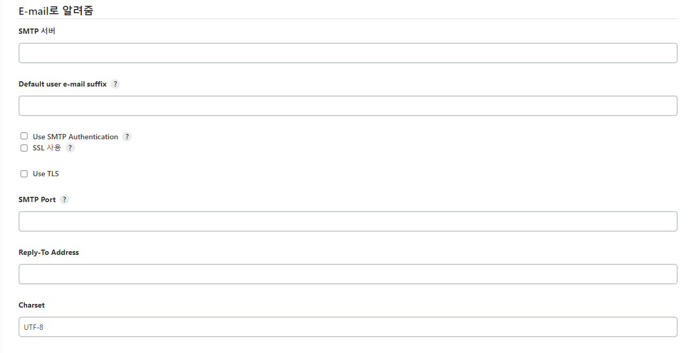
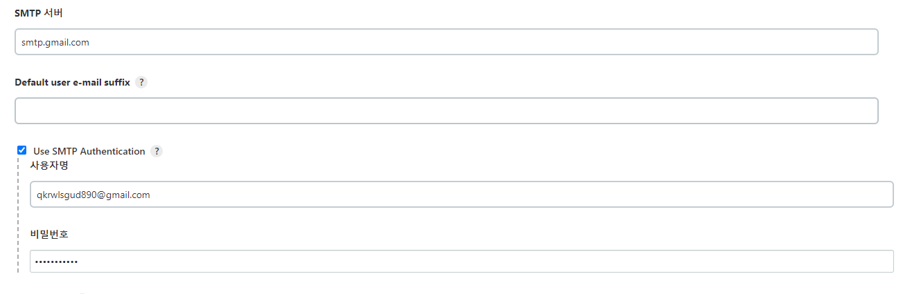
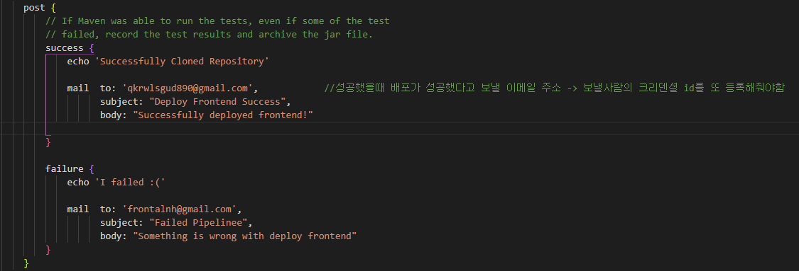

# 젠킨스 EMAIL 설정

### 젠킨스로 배포가 성공했을 때 이메일을 자동으로 발송해주는 기능이 있다.

Jenkins 대시보드 → Jenkins 관리 → 시스템 관리 → 맨 하단에 보면

고급을 클릭하면 이렇게 창이 펼쳐진다.

SMTP 서버 등록후 (저는 google로 등록함 )

중간에 Use SMTP Authentication 클릭하고 구글 아이디/ 비밀번호 입력하면 끝

**단, 이건 보내는 이에 대한 설정임 !**

이제 vscode 파이프라인에서 받는 사람의 메일 주소를 입력후 어떤 내용을 보낼지 적어주면  성공적으로 배포시 혹은 실패시 메일이 보내지는 것을 확인할 수 있는 준비가 끝났다.
