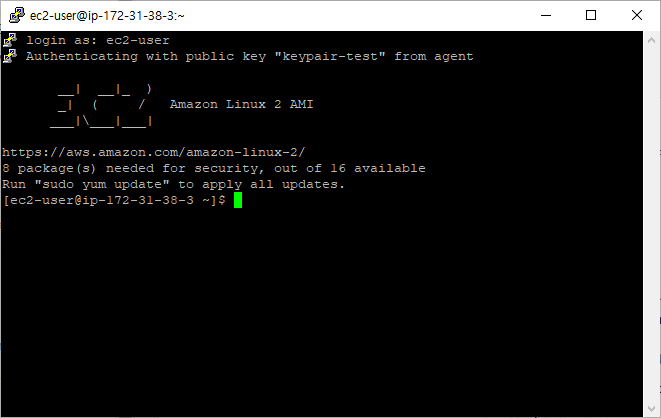
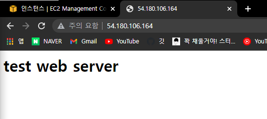

# 간단한 html파일 AWS 배포

1. aws 로그인
2. ec2탭의 키페어 생성
3. 인스턴스 생성
4. 키페어 등록
5. putty로 리눅스서버 로그인 (기본 아이디 : ec2-user)
6. 간단한 html 파일 생성

- 리눅스 명령어
  - root계정으로 변경 : \$sudo su -
  - Web서비스 실행 : #systemctl start httpd
  - 간단한 웹 페이지 구성 : #echo “\<h1>Test Web Server\</h1>”>/val/www/html/index.html
  - 웹 접속 확인 : #curl localhost

  
