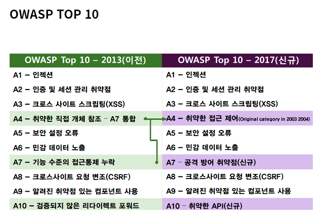

# OWASP란?

> 작성: 2022-02-21 · 태그: 네트워크 · [노션 원본](https://app.notion.com/p/dec0860da9b247da8000c999c861cf60)

**OWASP**(Open Web Application Security Project)는 **오픈소스 웹 어플리케이션 보안 프로젝트**

: OWASP는 가장 큰 오픈소스 웹 어플리케이션 보안 프로젝트로 주로 웹에 관한 정보노출, 악성 파일 및 스크립트, 보안 취약점 등을 연구하며, 10대 웹 어플리케이션의 취약점을 발표했다.

OWASP TOP 10은 웹 어플리케이션 취약점 중에서 빈도가 가장 많이 발생하고, 보안상 영향을 크게 줄 수 있는 것들 10가지를 선정한 문서이다.

Reperence : [https://12bme.tistory.com/98](https://12bme.tistory.com/98)
