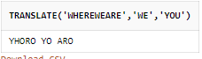
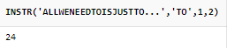

# 문자열 문법

> 작성: 2022-01-23 · 태그: ORACLE · [노션 원본](https://app.notion.com/p/076037f09f114850be19d20576e6850c)

## TRIM - 공백제거

- SELECT LTRIM(’           HELLO             ‘) FROM DUAL; : 왼쪽 공백을 모두 지워라
- SELECT RTRIM (’         HELLO             ‘) FROM DUAL;
  : 오른쪽 공백을 모두 지워라

- SELECT TRIM(’           HELLO               ‘) FROM DUAL;
  : 양쪽 공백을 모두 지워라

## SUBSTR - 문자열 자르기

- SELECT SUBSTR(’HELLO’,3,2) FROM DUAL;
  : 3번째 글씨부터 2개를 출력해라

- SELECT SUBSTRB(’안녕하세요’,4) FROM DUAL;
  : 비트단위로 문자열 자르기 → 한글은 하나에 3비트 영문은 1비트

## 문자열 소문자 또는 대문자로 변경하기

- SELECT LOWER(’NeWIEC’) FROM DUAL;
  :  모두 소문자로 변경  → newiec

- SELECT UPPER(’newWiec’) FROM DUAL;
  : 모두 대문자로 변경 → NEWWIEC

⇒ 주로 대소문자를 가리지않고 검색을 할 때 주로 사용된다.

예) SELECT \* FROM MEMBERS WHERE UPPER(MEMBER\_ID) = ‘SECRETJ’;

이러면 secretJ 이렇게 아이디를 만들었어도 찾을 수 있음.

## 문자열 대치 함수

- SELECT REPLACE(’WHERE WE ARE’, ‘WE’, ‘YOU’) FROM DUAL;
  : WHERE YOU ARE 로 출력  첫번째 값을 두번째 값으로 대치

- SELECT TRANSLATE(’WHERE WE ARE’, ‘WE’, ‘YOU’) FROM DUAL;
  : 단어 단위로 비교해서 W는 Y로 E는 O로 변경되고 U는 대치할 알파벳이 없으니 반응없다.

 

## 문자열 패딩 함수

- SELECT LPAD(’HELLO’,10,0) FROM DUAL;
  : 10개를 출력해라 LPAD는 좌측의 빈공간에 0을 채움

  → 즉 출력하고자 하는 범위는 2번째, 채울 값은 3번째

- SELECT RPAD(’HELLO’, 10, 1) FROM DUAL;
  : 마찬가지 오른쪽에 채움

## 문자열 검색 함수 INSTR

- SELECT INSTR(’ALL WE NEED TO IS JUST TO...’, ’IS’, 15,20) FROM DUAL;
  : 앞에 입력한 문자열에서 IS를 찾아라. 세 번째 인자는 찾기 시작할 위치

  네 번째 인자는 두 번째 찾은 인자의 위치

  

예) 회원의 전화번호에서 두 번째 대시(-) 문자가 존재하는 위치를 출력하시오

SELECT INSTR(’PHONE’,’-’, 1,2) FROM MEMBERS;

예) 회원의 전화번호에서 첫 번째 대시(-) 문자와 두 번째 대시(-) 문자 사이의 간격은?

SELECT INSTR(’PHONE’,’-’,1,2)-INSTR(’PHONE’,’-’, 1, 1)-1 FROM MEMBERS;

## 문자열 길이를 얻는 함수

- SELECT LENGTH(’WHERE WE ARE’) FROM DUAL;
  - 예 ) 모든 회원의 핸드폰 번호와 번호의 문자열 길이를 조회하시오.
    - SELECT PHONE, LENGTH(PHONE) FROM MEMBERS;
  - 예) 회원의 전화번호에 포함된 문자 ’-’를 없앤 전화번호의 길이를 출력하시오.
    - SELECT LENGTH(REPLACE(PHONE,’-’,’’)) FROM MEMBERS;
