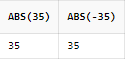
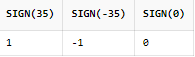
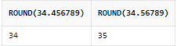
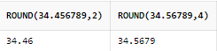
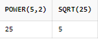

# 숫자 함수

> 작성: 2022-01-23 · 태그: ORACLE · [노션 원본](https://app.notion.com/p/78cbeca69b6441999ca01535999cce30)

## 절대값을 구하는 함수 ABS(n)

- SELECT **ABS(35), ABS(-35**) FROM DUAL;
  - ABS(ABSOLUTE)

  

## 음수/ 양수를 알려주는 함수 SIGN(n)

- SELECT **SIGN(35)**, SIGN(-35), SIGN(0) FROM DUAL;

: **양수는1, 음수는 -1, 0은 0**

## 반올림 값을 알려주는 함수 ROUND(n,i)

- SELECT ROUND(34.456789), ROUND(34.56789) FROM DUAL;

- SELECT **ROUND(34.456789,2**), ROUND(34.56789,4) FROM DUAL;
  - **두 번째 인자는 어느 자리까지** 표현할 것인지 옵션을 줄 수 있음.

## 숫자의 나머지 값을 반환하는 함수 MOD(n1, n2)

- SELECT **TRUNC(17/5)** 몫, **MOD(17,5)** 나머지 FROM DUAL;

## 숫자의 제곱을 구하는 함수와 제곱근을 구하는 함수 POWER(n1,n2)/ SQRT(n)

- SELECT **POWER(5,2), SQRT(25)** FROM DUAL;
  
