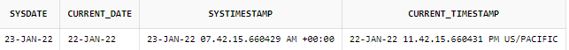
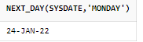
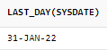
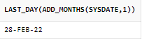

# 날짜 함수

## 현재 시간을 얻는 함수

- SELECT SYSDATE, CURRENT\_DATE, SYSTIMESTAMP, CURRENT\_TIMESTAMP FROM DUAL;
  

  

## 세션 시간과 포맷 변경

- ALTER SESSION SET TIME\_ZONE =’-1.0’
- ALTER SESSION SET NLS\_DATE\_FORMAT=’YYYY-MM-DD HH24:MI:SS’;

  - 설정 값을 변경해서 사용할 수 있다. → 연도수 4개 월 2개 날 2개 24시간개념이고 분초까지 표현한다.
- ALTER SESSION SET TIME\_ZONE = ‘09:00’;

  - 한국의 타임존으로 변경할 수 있다.

## 날짜 추출 함수 EXTRACT

- SELECT EXTRACT(YEAR FROM SYSDATE) FROM DUAL;
- SELECT EXTRACT(MONTH FROM SYSDATE) FROM DUAL;
- SELECT EXTRACT(DAY FROM SYSDATE) FROM DUAL;
- SELECT EXTRACT(MINUTE FROM SYSDATE) FROM DUAL;
- SELECT EXTRACT(SECOND FROM SYSDATE) FROM DUAL;
  - 예) 가입 회원 중에 비수기(2,3,11,12)월 달에 가입한 회원을 조회하시오
    - SELECT \* FROM MEMBERS WHERE EXTRACT(MONTH FROM REGDATE) IN (2,3,11,12);

## 날짜 누적 함수 ADD\_MONTH(날짜, 정수)

- SELECT **ADD\_MONTHS(SYSDATE, 1)** FROM DUAL;
  - → 현재 날짜에서 1개월 후를 조회
- SELECT ADD\_MONTHS(SYSDATE, -1) FROM DUAL;
  - → 현재 날짜에서 1개월 전을 조회
  - 예) 가입한지 6개월이 안된 회원을 조회하시오.
    - SELECT \* FROM MEMBERS WHERE ADD\_MONTH(SYSDATE,-6) \< REGDATE

## 날짜의 차이를 알아내는 함수 MONTHS\_BETWEEN(날짜, 날짜)

- SELECT MONTHS\_BETWEEN(SYSDATE, TO\_DATE(’2022-01-22’)) FROM DUAL;
  - 예) 가입한지 6개월이 안된 회원을 조회하시오.
    - SELECT \* FROM MEMBERS WHERE MONTHS\_BETWEEN(SYSDATE, REGDATE)\<6;

## 다음 요일을 알려주는 함수 NEXT\_DAY(현재날짜, 다음요일)

- SELECT NEXT\_DAY(SYSDATE, ‘MONDAY’) FROM DUAL;
  - 돌아오는 주의 해당 요일의 날짜를 검색해준다.

## 월의 마지막 일자를 알려주는 함수 LAST\_DAY(날짜)

- SELECT LAST\_DAY(SYSDATE) FROM DUAL;

- 응용) 다음달의 마지막 날을 알려주시오.
  - SELECT LAST\_DAY(ADD\_MONTHS(SYSDATE, 1)) FROM DUAL;
    
