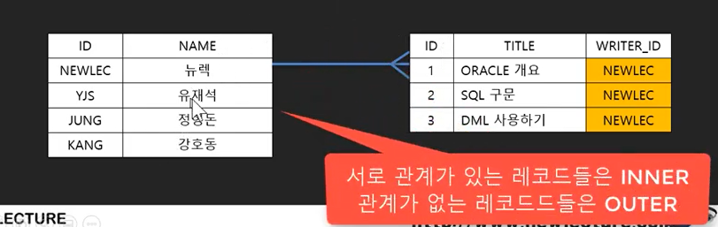
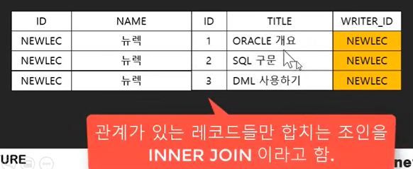
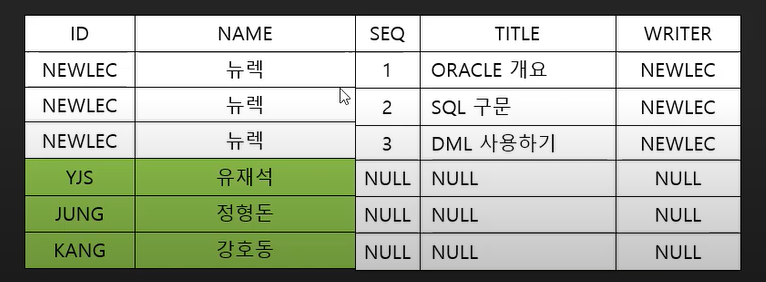
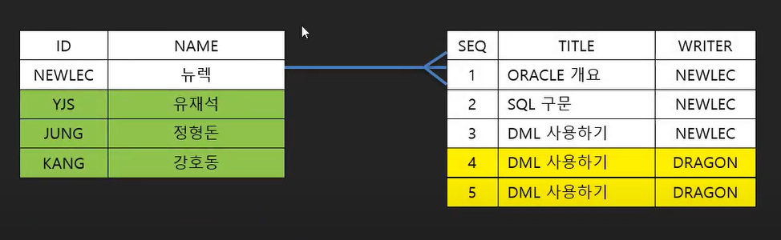
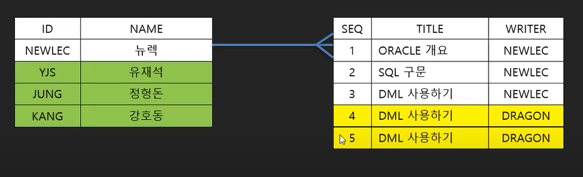
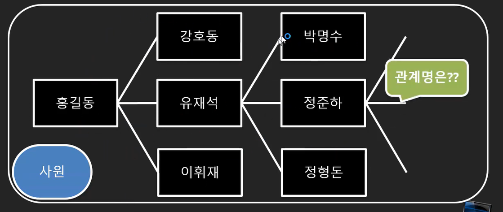
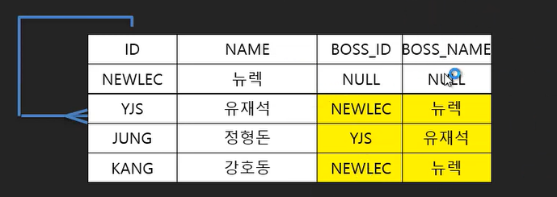

# JOIN(조인)

### 테이블을 합치는 기법

SELECT \* FROM MEMBER;

SELECT \* FROM NOTICE;

두 테이블을 조인해보자

- SELECT \* FROM MEMBER INNER JOIN NOTICE ON [MEMBER.ID](http://MEMBER.ID) =NOTICE.WRITER\_ID;

⇒ 기준 테이블 JOIN 합칠 테이블 ON 조인할 조건



- 관계가 **있는** 레코드는 **INNER**
- 관계가 **없는** 레코드는 **OUTER**가 된다.



여기선 글을 쓴 회원은 INNER

글을 쓰지 않은 회원은 OUTER가 된다.

## INNER JOIN

- SELECT \* FROM MEMBERS M INNER JOIN NOTICE N ON M.Member\_ID=N.Writer;
  - MEMBERS 테이블과 NOTICE 테이블의 조건에 맞는 부분만 보여주겠다는 것

## OUTER JOIN

- LEFT/RIGHT/FULL OUTER JOIN 이렇게 세 종류가 있음(OUTER 생략 가능)
  - LEFT는 먼저 선언한 테이블의 키 값에 맞지 않는 부분도 보여주겠다는 것

  

  - RIGHT는 나중에 선언한 테이블의 키 값에 맞지 않는 부분도 보여주겠다는 것
  - FULL은 전부 보여주겠다는 것

  ```sql
  //오라클에서 JOIN 문법은 ANCI와 다르다.
  SELECT * FROM MEMBER M, NOTICE N
  WHERE M.ID=N.WRITER(+)
  
  //이런식으로 조인할 테이블을 나열하고 WHERE에서 조건을 건다.
  // (+)가 있는 부분은 OUTER 조인할 부분이다.
  ```

  

  
- 다음 테이블을 RIGHT OUTER JOIN을 하면 총 레코드 개수는 몇 개인가?



5개

- 다음 테이블을 FULL OUTER JOIN을 하면 총 레코드 개수는 몇 개인가?



8개

## SELF JOIN

: 같은 테이블끼리 조인

- 데이터가 서로 포함 관계를 가지는 경우 : 담당, 구성, 연락



- 참조 컬럼이 필요함


