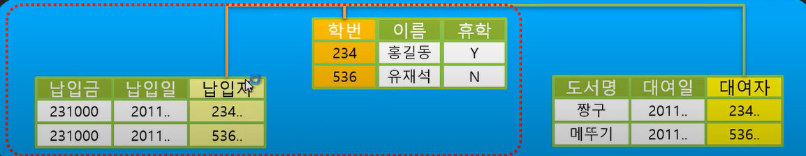
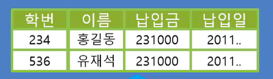
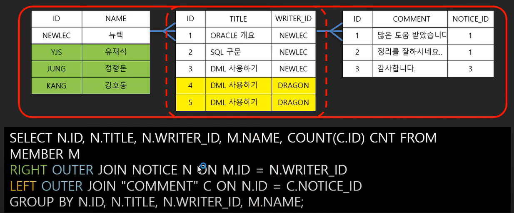
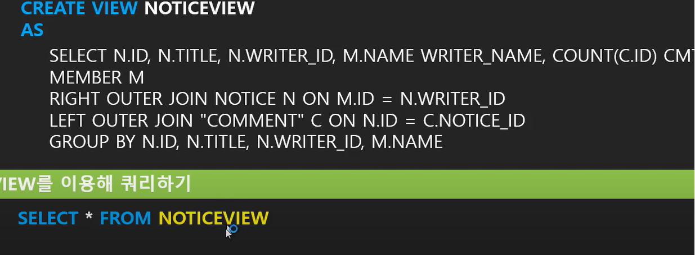
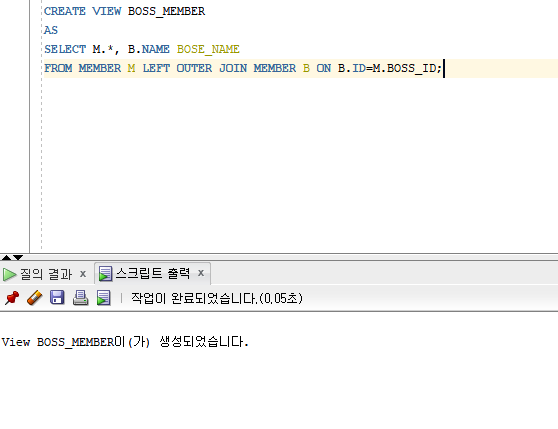
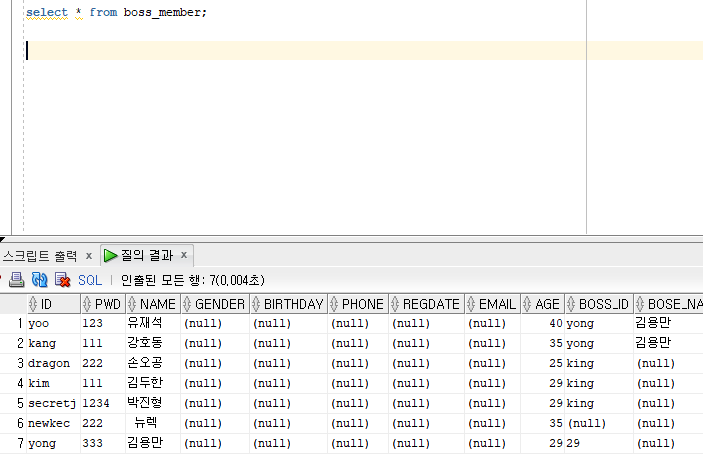

# VIEW

### VIEW가 생기게 된 이유?

물리적인 데이터구조인 TABLE은



이 모습처럼 정규화되어 분리되어 있다.

근데 우리가 실제로 사용할 때는 이 테이블들을 합쳐서 사용하게 되는데

업무적으로 자주 쓰이는 쿼리를 매번 합치기 불편하기 때문에

합쳐놓은 쿼리문을 VIEW로 정의해서 마치 테이블처럼 가져다 쓸 수 있게 되었다.





위 사진처럼 세 테이블을 모두 합쳐 사용하려고 두 번의 JOIN을 한 것을 볼 수 있다.

그래서 이것을 뷰로 만들게 되면



이처럼 한번 정의하고 쉽게 가져가서 쓸 수 있는 것을 볼 수 있다.


### VIEW 생성법

```sql
CREATE VIEW ‘생성할 VIEW명’
AS
(
쿼리
)
```



**Oracle SQL Developer 대시보드에 뷰에서 생성된 뷰를 확인할 수 있다.**



**⇒ 이렇게 생성한 뷰 사용 가능한 것을 확인 가능 !**
