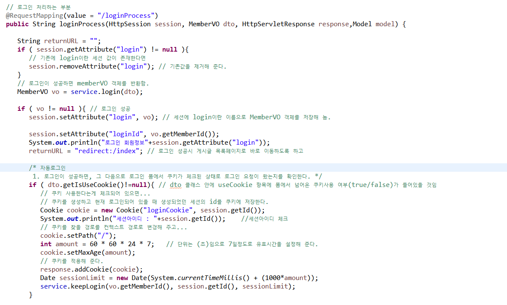

# 로그인



Nplit의 로그인 프로세스는 spring security를 사용하지 않고 session과 cookie를 사용해서 구현했다.

### 기본 로그인

- 동작 원리는 우선 **로그인에 성공시 세션에 login이라는 이름으로 객체를 생성**한다.
- 프로세스를 돌리기 이전에 **기존에 생성된 login이 있는 지 확인하고 있다면 제거**한다.
- 기본적인 로그인은 쿼리문으로 파라미터로 입력된 아이디와 패스워드를 비교해서 사용자의 정보를 세션에 담아주는 것으로 간단히 구현되어있는데<br><br>프로젝트 기간이 짧았기 때문에 spring security의 개념을 정확히 알고 만들 수 있는 시간이 허락되지 않아서 기본 로그인은 간단히 구현했다.

### 자동로그인

- 조금 심화시켜서 쿠키와 세션의 차이와 개념을 짚고 넘어가고 싶어서 자동로그인 기능을 구현을 했다.<br><br>동작 원리는<br>1. view에서  자동 로그인 체크박스에 사용자가 체크를 하면 IsUseCookie 객체에 Y라는 값이 들어간다. <br><br>2. 컨트롤러에서 IsUseCookie가 존재하면 자동로그인을 하기 위한 loginCookie를 생성하고 그 안에는 세션ID를 저장한다.
  <br>3. 쿠키의 유효기간과 컨텍스트 경로를 지정해준다.

  <br>4. 쿠키를 적용시킨다.<br><br>5.  이 적용된 쿠키를 활용해서 로그인을 유지 시켜주기 위한 keeplogin service를 구현을 했는데

  UserDAO

  ```c
  public void keepLogin(String memberId, String sessionId,Date next){
  
          Map<String, Object> map = new HashMap<String,Object>();
          map.put("memberId", memberId);
          map.put("sessionId", sessionId);
          map.put("next", next);
  
          sqlSession.update("com.nplit.mapper.UserMapper.keepLogin",map);
      }
  ```

**Mapper** ```c <!-- 로그인된 경우 해당 세션id와 유효시간을 사용자 테이블에 세팅한다. --> <update id="keepLogin"> update member set sessionKey = #{sessionId}, sessionLimit = #{next} where memberId=#{memberId} </update> ``` member테이블에 sessionKey(세션아이디)와 sessionLimit(유효기간)을 세팅시켜준다.  **근데 이제 이 담은 쿠키를 생성한 것을 로그인 프로세스가 돌기 이전에 검증을 해야 다시 브라우저를 닫고 켰을 때 적용이 될텐데 ....**   **⇒ 그건 AOP를 활용한 인터셉터를 활용해서 prehandle을 만들어서 검증했다.**  ### 자동 로그인 인터셉터
