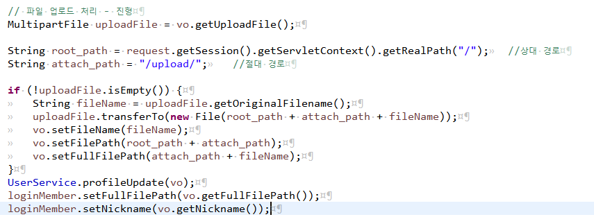
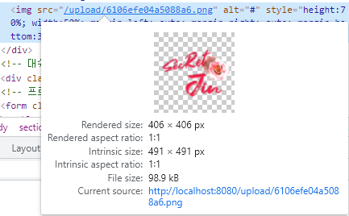

# 서버 이전 시 파일 업로드 경로

> 작성: 2022-01-05 · [노션 원본](https://app.notion.com/p/e4c91bc8c6ae478db9b01b053dfda0e9)

파일 업로드를 상대 경로+절대 경로+파일 이름으로 설정을 했었다.

root\_path는 상대 경로로 도메인을 가져오는 부분

attach\_path는 파일이 저장되는 폴더의 경로

fileName은 파일의 오리지널 이름

즉 여기서 - http://localhost:8080은 root\_path, - /upload/ 는 attach\_path - fileName은 6106efe04a5088a6.png 이 되겠다.

### 기존 로컬에서 업로드 처리할 때는 문제가 안되었지만, AWS를 배포하고 탄력적 IP(고정된 IP)를 사용하지 않고 사용을 했더니, 도메인 명이 인스턴스가 재시작할 때마다 변경되었고, 파일을 읽어오지 못하는 문제가 발생함

- **해결 방법**으로
  1. 탄력적 IP사용으로 고정된 IP 주소를 사용한다 (돈이 든다)
  2. 상대 경로가 설정이 맞지 않으니 수정이 필요한 것 같은데, 뭐가 문젠지 모르는 게 문제다 \^\^
