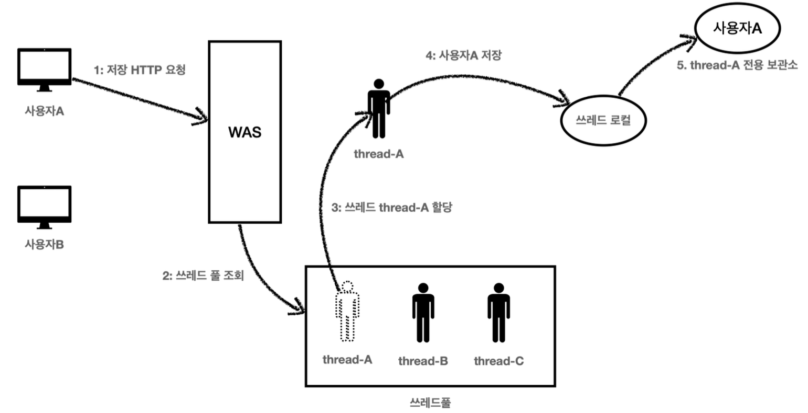
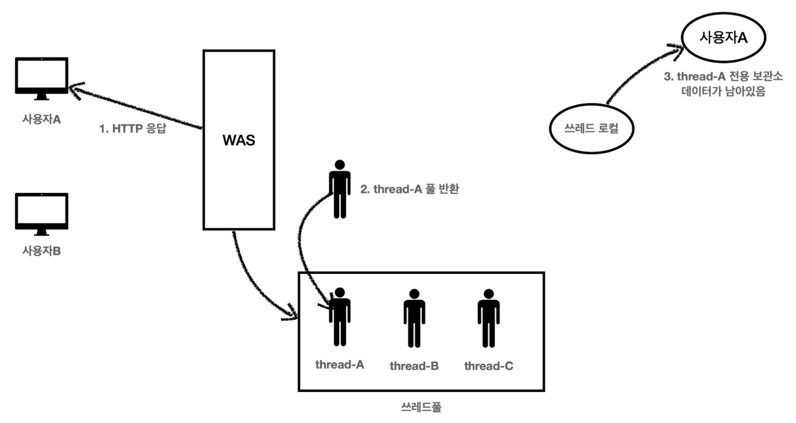
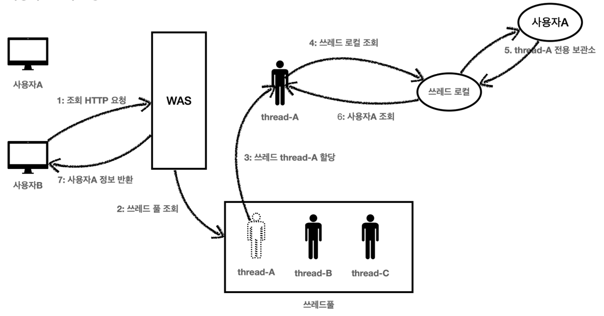

# 2. 쓰레드 로컬

> 작성: 2024-07-15 · 태그: spring, java · [노션 원본](https://app.notion.com/p/3543c8f5e0184223bdcc85f91d89246c)

## 필드 동기화 - 개발

앞서 만들었던 **로그 추적기의 문제(TraceId 를 파라미터로 넘기는 문제)**를 해결하기 위해서 새로운 로그 추적기를 만듬. (로직 개선)

### LogTrace 인터페이스

```java
public interface LogTrace {

	TraceStatus begin(String message);

	void end(TraceStatus status);

	void exception(TraceStatus status, Exception e);
}
```

### FieldLogTrace 구현체

: 파라미터를 넘기지 않고 TraceId를 동기화 할 수 있는 FieldLogTrace 구현체

traceHolder라는 객체를 관리하여 파라미터를 넘기지않고 동기화를 한다.

하지만 싱글톤으로 만들어진 구현체의 필드이다보니 동시성 이슈가 발생했다. (함께 사용하는 필드)

```java
@Slf4j
public class FieldLogTrace implements LogTrace {

	private static final String START_PREFIX = "-->";

	private static final String COMPLETE_PREFIX = "<--";

	private static final String EX_PREFIX = "<X-";

	private TraceId traceIdHolder; //traceId 동기화, 동시성 이슈 발생

	@Override
	public TraceStatus begin(String message) {
		syncTraceId();
		TraceId traceId = traceIdHolder;
		Long startTimeMs = System.currentTimeMillis();
		log.info("[{}] {}{}", traceId.getId(), addSpace(START_PREFIX,
			traceId.getLevel()), message);
		return new TraceStatus(traceId, startTimeMs, message);
	}

	@Override
	public void end(TraceStatus status) {
		complete(status, null);
	}

	@Override
	public void exception(TraceStatus status, Exception e) {
		complete(status, e);
	}

	private void complete(TraceStatus status, Exception e) {
		Long stopTimeMs = System.currentTimeMillis();
		long resultTimeMs = stopTimeMs - status.getStartTimeMs();
		TraceId traceId = status.getTraceId();

		if (e == null) {
			log.info("[{}] {}{} time={}ms", traceId.getId(),
				addSpace(COMPLETE_PREFIX, traceId.getLevel()), status.getMessage(),
				resultTimeMs);
		} else {
			log.info("[{}] {}{} time={}ms ex={}", traceId.getId(),
				addSpace(EX_PREFIX, traceId.getLevel()), status.getMessage(), resultTimeMs,
				e.toString());
		}

		releaseTraceId();
	}

	private void syncTraceId() {
		if (traceIdHolder == null) {
			traceIdHolder = new TraceId();
		} else {
			traceIdHolder = traceIdHolder.createNextId();
		}
	}

	// 다 사용 후 초기화
	private void releaseTraceId() {
		if (traceIdHolder.isFirstLevel()) {
			traceIdHolder = null; //destroy
		} else {
			traceIdHolder = traceIdHolder.createPreviousId();
		}
	}
...
}
```

테스트 코드드

```java
@Test
void begin_end_level2() {
	TraceStatus status1 = trace.begin("hello1");
	TraceStatus status2 = trace.begin("hello2");
	trace.end(status2);
	trace.end(status1);
}

// 정상 출력 (동시성 테스트 X)
// [ed72b67d] hello1
// [ed72b67d] |-->hello2
// [ed72b67d] |<--hello2 time=2ms
// [ed72b67d] hello1 time=6ms
```

## 필드 동기화 - 적용

LogTrace 스프링 빈 등록

```java
@Configuration
public class LogTraceConfig {

	@Bean
	public LogTrace logTrace() {
		return new FieldLogTrace();
	}
}
```

컨트롤러

```java
@RestController
@RequiredArgsConstructor
public class OrderControllerV3 {

	private final OrderServiceV3 orderService;

	private final LogTrace trace; // FieldLogTrace 구현체 주입

	@GetMapping("/v3/request")
	public String request(String itemId) {
		TraceStatus status = null;
		try {
			status = trace.begin("OrderController.request()");
			orderService.orderItem(itemId); // 파라미터 전달 부분이 사라짐
			trace.end(status);
			return "ok";
		} catch (Exception e) {
			trace.exception(status, e);
			throw e;
		}
	}
}

// 정상 출력
// [f8477cfc] OrderController.request()
// [f8477cfc] |-->OrderService.orderItem()
// [f8477cfc] | |-->OrderRepository.save()
// [f8477cfc] | |<--OrderRepository.save() time=1004ms
// [f8477cfc] |<--OrderService.orderItem() time=1006ms
// [f8477cfc] OrderController.request() time=1007ms
```

## 필드 동기화 - 동시성 문제

사실 FieldLogTrace 는 심각한 동시성 문제를 가지고 있음. (동시성 문제를 확인하려면 다음과 같이 동시에 여러번 호출해보면 된다)

```javascript
 // 기대하는 정상 출력
 [nio-8080-exec-3] [52808e46] OrderController.request()
 [nio-8080-exec-3] [52808e46] |-->OrderService.orderItem()
 [nio-8080-exec-3] [52808e46] |   |-->OrderRepository.save()
 [nio-8080-exec-4] [4568423c] OrderController.request()
 [nio-8080-exec-4] [4568423c] |-->OrderService.orderItem()
 [nio-8080-exec-4] [4568423c] |   |-->OrderRepository.save()
 [nio-8080-exec-3] [52808e46] |   |<--OrderRepository.save() time=1001ms
 [nio-8080-exec-3] [52808e46] |<--OrderService.orderItem() time=1001ms
 [nio-8080-exec-3] [52808e46] OrderController.request() time=1003ms
 [nio-8080-exec-4] [4568423c] |   |<--OrderRepository.save() time=1000ms
 [nio-8080-exec-4] [4568423c] |<--OrderService.orderItem() time=1001ms
 [nio-8080-exec-4] [4568423c] OrderController.request() time=1001ms

 // 기대 출력 쓰레드 분리
 [nio-8080-exec-3] [52808e46] OrderController.request()
 [nio-8080-exec-3] [52808e46] |-->OrderService.orderItem()
 [nio-8080-exec-3] [52808e46] |   |-->OrderRepository.save()
 [nio-8080-exec-3] [52808e46] |   |<--OrderRepository.save() time=1001ms
 [nio-8080-exec-3] [52808e46] |<--OrderService.orderItem() time=1001ms
 [nio-8080-exec-3] [52808e46] OrderController.request() time=1003ms

 [nio-8080-exec-4] [4568423c] OrderController.request()
 [nio-8080-exec-4] [4568423c] |-->OrderService.orderItem()
 [nio-8080-exec-4] [4568423c] |   |-->OrderRepository.save()
 [nio-8080-exec-4] [4568423c] |   |<--OrderRepository.save() time=1000ms
 [nio-8080-exec-4] [4568423c] |<--OrderService.orderItem() time=1001ms
 [nio-8080-exec-4] [4568423c] OrderController.request() time=1001ms

 // 실제 출력 - 동시성 문제 발생
 [nio-8080-exec-3] [aaaaaaaa] OrderController.request()
 [nio-8080-exec-3] [aaaaaaaa] |-->OrderService.orderItem()
 [nio-8080-exec-3] [aaaaaaaa] |   |-->OrderRepository.save()
 [nio-8080-exec-4] [aaaaaaaa] |   |   |-->OrderController.request()
 [nio-8080-exec-4] [aaaaaaaa] |   |   |   |-->OrderService.orderItem()
 [nio-8080-exec-4] [aaaaaaaa] |   |   |   |   |-->OrderRepository.save()
 [nio-8080-exec-3] [aaaaaaaa] |   |<--OrderRepository.save() time=1005ms
 [nio-8080-exec-3] [aaaaaaaa] |<--OrderService.orderItem() time=1005ms
 [nio-8080-exec-3] [aaaaaaaa] OrderController.request() time=1005ms
 [nio-8080-exec-4] [aaaaaaaa] |   |   |   |   |<--OrderRepository.save()
time=1005ms
 [nio-8080-exec-4] [aaaaaaaa] |   |   |   |<--OrderService.orderItem()
time=1005ms
 [nio-8080-exec-4] [aaaaaaaa] |   |   |<--OrderController.request() time=1005ms

 // 분리한 실제 출력
 [nio-8080-exec-3] [aaaaaaaa] OrderController.request()
 [nio-8080-exec-3] [aaaaaaaa] |-->OrderService.orderItem()
 [nio-8080-exec-3] [aaaaaaaa] |   |-->OrderRepository.save()
 [nio-8080-exec-3] [aaaaaaaa] |   |<--OrderRepository.save() time=1005ms
 [nio-8080-exec-3] [aaaaaaaa] |<--OrderService.orderItem() time=1005ms
 [nio-8080-exec-3] [aaaaaaaa] OrderController.request() time=1005ms
 [nio-8080-exec-4]
 [nio-8080-exec-4] [aaaaaaaa] |   |   |-->OrderController.request()
 [nio-8080-exec-4] [aaaaaaaa] |   |   |   |-->OrderService.orderItem()
 [nio-8080-exec-4] [aaaaaaaa] |   |   |   |   |-->OrderRepository.save()
 [nio-8080-exec-4] [aaaaaaaa] |   |   |   |   |<--OrderRepository.save()
time=1005ms
 [nio-8080-exec-4] [aaaaaaaa] |   |   |   |<--OrderService.orderItem()
time=1005ms
 [nio-8080-exec-4] [aaaaaaaa] |   |   |<--OrderController.request() time=1005ms

 // 동일한 트랜잭션 ID와 레벨이 꼬인 것을 확인할 수 있다.
```

FieldLogTrace 는 싱글톤으로 등록된 스프링 빈이므로, 해당 인스턴스의 FieldLogTrace.traceIdHolder 필드를 여러 쓰레드가 동시에 접근하게 될 때 문제가 발생한다. (힙 영역은 여러 쓰레드가 공유함)

여러 쓰레드가 동시에 **같은 인스턴스**의 필드 값을 변경하면서 발생하는 문제를 동시성 문제라 한다. <br><br>이런 동시성 문제는 여러 쓰레드가 같은 인스턴스의 필드에 접근해야 하기 때문에 트래픽이 적은 상황에서는 확률상 잘 나타나지 않고, 트래픽이 점점 많아질 수 록 자주 발생한다.<br><br>특히 스프링 빈 처럼 싱글톤 객체의 필드를 변경하며 사용할 때 이러한 동시성 문제를 조심해야 한다.

이럴 때 사용하는 것이 바로 쓰레드 로컬이다

## ThreadLocal - 소개

**쓰레드 로컬은 해당 쓰레드만 접근할 수 있는 특별한 저장소**를 말한다. 쉽게 이야기해서 물건 보관 창구를 떠올리면 된다.

<br>여러 사람이 같은 물건 보관 창구를 사용하더라도 창구 직원은 사용자를 인식해서 사용자별로 확실하게 물건을 구분해준다.<br>

사용자A, 사용자B 모두 창구 직원을 통해서 물건을 보관하고, 꺼내지만 창구 지원이 사용자에 따라 보관한 물건을 구분해주는 것이다.

- 쓰레드 로컬을 사용하면 **각 쓰레드마다 별도의 내부 저장소를 제공**한다. 따라서 같은 인스턴스의 쓰레드 로컬 필드에 접근해도 문제 없다.
- 자바는 언어차원에서 쓰레드 로컬을 지원하기 위한 **java.lang.ThreadLocal** 클래스를 제공한다.

## ThreadLocal - 예제 코드

```java
@Slf4j
public class ThreadLocalService {

	// String 타입에서 ThreadLocal을 사용하도록 변경
	private ThreadLocal<String> nameStore = new ThreadLocal<>();

	public String logic(String name) {
		log.info("저장 name={} -> nameStore={}", name, nameStore.get());
		nameStore.set(name);
		sleep(1000);
		log.info("조회 nameStore={}", nameStore.get());
		return nameStore.get();
	}

	private void sleep(int millis) {
		try {
			Thread.sleep(millis);
		} catch (InterruptedException e) {
			e.printStackTrace();
		}
	}
}
```

ThreadLocal 사용법

- 값 저장: ThreadLocal.set(xxx)
- 값 조회: ThreadLocal.get()
- 값 제거: ThreadLocal.remove()

> ***주의****<br>*
>
> ***해당 쓰레드가 쓰레드 로컬을 모두 사용하고 나면*** ***ThreadLocal.remove()*** ***를 호출해서 쓰레드 로컬에 저장<br>된 값을 제거해주어야 한다.<br><br>이유는*** ***쓰레드로컬 - 주의사항******에서 서술***

## 쓰레드 로컬 동기화 - 개발

FieldLogTrace 에서 발생했던 동시성 문제를 ThreadLocal 로 해결해보자.

<br>**TraceId traceIdHolder** 필드를 쓰레드 로컬을 사용하도록 **ThreadLocal\<TraceId> traceIdHolder** 로<br>변경하면 된다.

```java
@Slf4j
public class FieldLogTrace implements LogTrace {

	private static final String START_PREFIX = "-->";

	private static final String COMPLETE_PREFIX = "<--";

	private static final String EX_PREFIX = "<X-";

	// private TraceId traceIdHolder; //traceId 동기화, 동시성 이슈 발생
	private ThreadLocal<TraceId> traceIdHolder = new ThreadLocal<>();

	...

  private void syncTraceId() {
 	 TraceId traceId = traceIdHolder.get();

 	 if (traceId == null) {
 	 	 traceIdHolder.set(new TraceId()); // set
 	 } else {
 		 traceIdHolder.set(traceId.createNextId());
 	 }
  }

 ...
}
```

traceIdHolder 가 필드에서 ThreadLocal 로 변경되었다. <br>따라서 값을 저장할 때는 set(..) 을 사용하고, 값을 조회할 때는 get() 을 사용한다.

## 쓰레드 로컬 동기화 - 적용

```java
@Configuration
public class LogTraceConfig {

	@Bean
	public LogTrace logTrace() {
		//return new FieldLogTrace();
		return new ThreadLocalLogTrace();
	}
}
```

동시성 문제가 있는 **FieldLogTrace** 대신에 문제를 해결한 **ThreadLocalLogTrace** 를 스프링 빈으로 등록.

애플리케이션 실행 후 API 요청 시, 로그가 정상적으로 출력된다.

## 쓰레드 로컬 - 주의사항

쓰레드 로컬의 값을 사용 후 제거하지 않고 그냥 두면 WAS(톰캣)처럼 **쓰레드 풀을 사용하는 경우**에 심각한 문제가발생할 수 있다.

쓰레드는 사용된 후 삭제되지 않고 쓰레드 풀에 반환되고, 다음에 쓰레드가 필요할 경우 재사용된다. (물론 다른 쓰레드가 반환 될 수도 있다)

여기서 문제가 발생된다.

쓰레드가 반환되고 재사용 되는 시점에, 쓰레드 로컬 변수에 값이 살아있기 때문에 의도하지 않은 문제가 발생될 수 있다.

**따라서, 쓰레드를 반환하기 직전에는 쓰레드 로컬 변수의 값을 반드시 삭제하고 반환해야한다.**

<details>
<summary>**예시**</summary>

**사용자A 저장 요청**



1. 사용자A가 저장 HTTP를 요청했다.
2. WAS는 쓰레드 풀에서 쓰레드를 하나 조회한다.
3. 쓰레드 <code>thread-A</code> 가 할당되었다.
4. <code>thread-A</code> 는 <code>사용자A</code> 의 데이터를 쓰레드 로컬에 저장한다.
5. 쓰레드 로컬의 <code>thread-A</code> 전용 보관소에 <code>사용자A</code> 데이터를 보관한다.<br>

**사용자A 저장 요청 종료**



1. 사용자A의 HTTP 응답이 끝난다.
2. WAS는 사용이 끝난 <code>thread-A</code> 를 쓰레드 풀에 반환한다. 쓰레드를 생성하는 비용은 비싸기 때문에 쓰레드를 제거하지 않고, 보통 쓰레드 풀을 통해서 쓰레드를 재사용한다.
3. <code>thread-A</code> 는 쓰레드풀에 아직 살아있다. 따라서 쓰레드 로컬의 <code>thread-A</code> 전용 보관소에 <code>사용자A</code> 데이터도 함께 살아있게 된다.<br>

**사용자B 조회 요청**



1. 사용자B가 조회를 위한 새로운 HTTP 요청을 한다.
2. WAS는 쓰레드 풀에서 쓰레드를 하나 조회한다.
3. 쓰레드 <code>thread-A</code> 가 할당되었다. (물론 다른 쓰레드가 할당될 수 도 있다.)
4. 이번에는 조회하는 요청이다. <code>thread-A</code> 는 쓰레드 로컬에서 데이터를 조회한다.
5. 쓰레드 로컬은 <code>thread-A</code> 전용 보관소에 있는 <code>사용자A</code> 값을 반환한다.
6. 결과적으로 <code>사용자A</code> 값이 반환된다.
7. 사용자B는 사용자A의 정보를 조회하게 된다.

결과적으로 사용자B는 사용자A의 데이터를 확인하게 되는 심각한 문제가 발생하게 된다.

이런 문제를 예방하려면 사용자A의 요청이 끝날 때 쓰레드 로컬의 값을 <code>ThreadLocal.remove()</code> 를 통해서 꼭 제거해야 한다.

</details>
