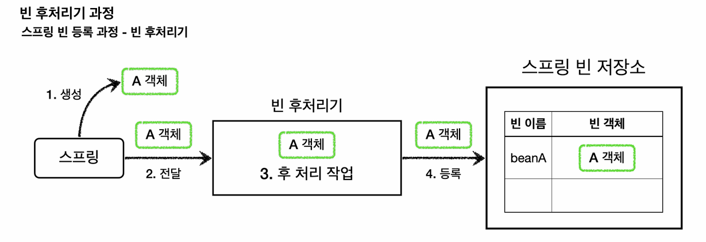
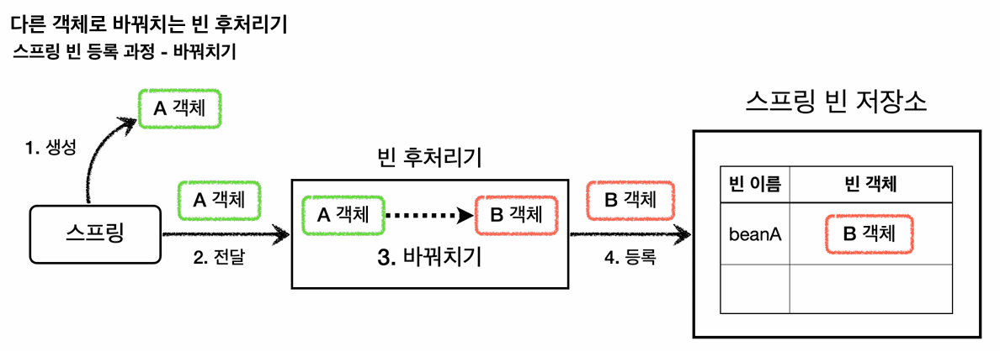
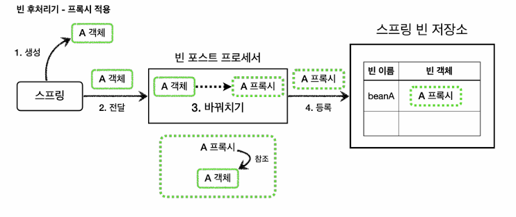
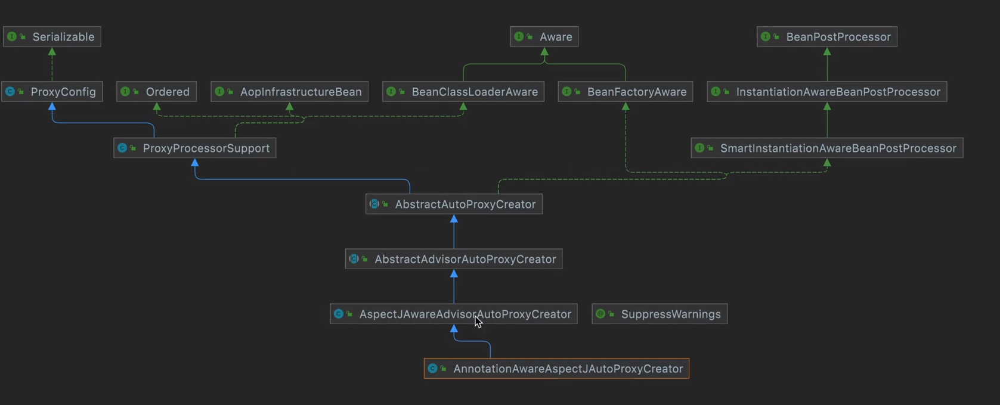
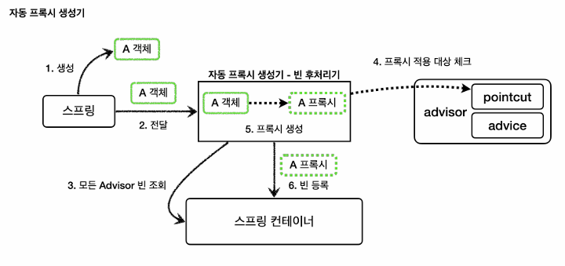
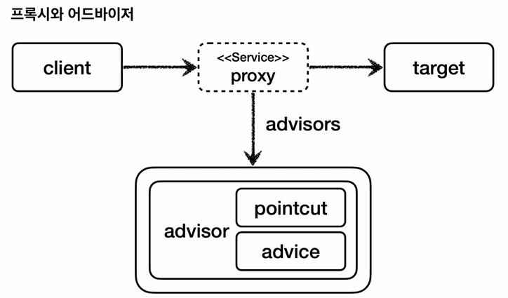
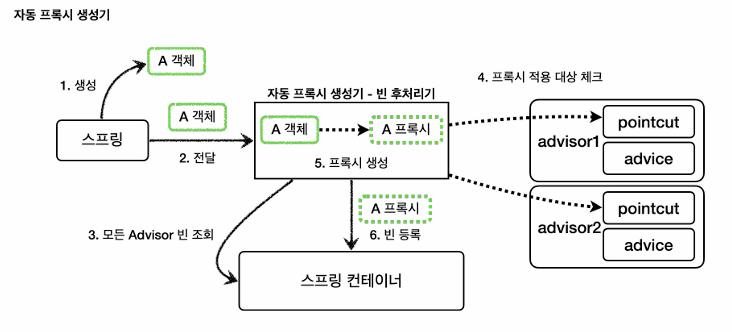
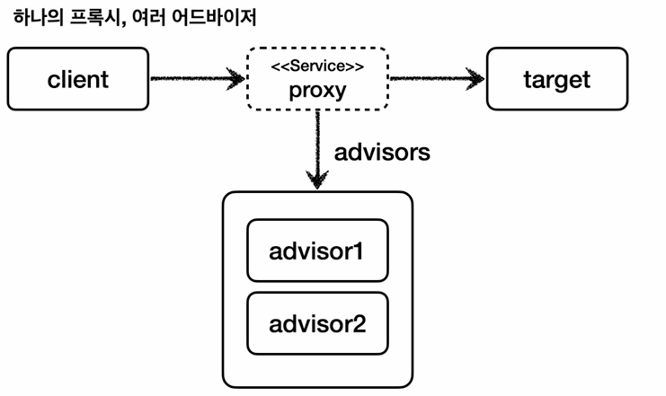

# 7. 빈 후처리기

*※ 이전 강의에서 <br>config 파일에 bean마다 프록시를 적용시키기 위해 중복된 코드들을 넣어줘야했던 문제점 <br>및 컴포넌트 스캔을 사용한 빈에는 적용시키지 못하는 문제점이 있었다. <br>그 문제점을 빈 후처리기를 통해 해결해보자*

## 📋빈 후처리기란 - BeanPostProcessor

: 스프링이 빈 저장소에 등록할 목적으로 생성한 객체를 빈 저장소에 등록하기 직전에 조작하고 싶다면 빈 후처리기를 사용하면 된다.<br>빈 포스트 프로세서 (<code>BeanPostProcessor)는 번역하면 빈 후처리기인데, 이름 그대로 빈을 생성한 후에 무언가를</code>처리하는 용도로 사용한다

### 빈 후처리기 기능

: 객체를 조작할 수도 있고 완전히 다른 객체로 바꿔치기 하는 것도 가능하다.



빈 등록 과정을 빈 후처리기와 함께 살펴보자

1. 생성:<br>스프링 빈 대상이 되는 객체를 생성한다. (@Bean, 컴포넌트 스캔 모두 포함)
2. 전달:<br>생성된 객체를 빈 저장소에 등록하기 직전에 빈 후처리기에 전달한다.
3. 후 처리 작업:<br>빈 후처리기는 전달된 스프링 빈 객체를 조작하거나 다른 객체로 바뀌치기 할 수 있다.
4. 등록:<br>빈 후처리기는 빈을 반환한다. 전달 된 빈을 그대로 반환하면 해당 빈이 등록되고, 바꿔치기 하면 다른 객체가 빈 저장소에 등록된다



## 📋예제 코드

### 일반적인 빈 등록 코드

```java
public class BasicTest {

    @Test
    void basicConfig() {
        ApplicationContext applicationContext = new AnnotationConfigApplicationContext(BasicConfig.class);

        // A는 빈으로 등록된다.
        A a = applicationContext.getBean("beanA", A.class);
        a.helloA();
  
        // B는 빈으로 등록되지 않는다.
        //B bean = applicationContext.getBean(B.class);
        Assertions.assertThrows(NoSuchBeanDefinitionException.class,
                () -> applicationContext.getBean(B.class));
       //NoSuchBeanDeficitionException이 발생했으므로 테스트 성공
    }

    @Slf4j
    @Configuration
    static class BasicConfig {
        @Bean(name = "beanA")
        public A a() {
            return new A();
        }
    }

    @Slf4j
    static class A {
        public void helloA() {
            log.info("hello A");
        }
    }

    @Slf4j
    static class B {
        public void helloB() {
            log.info("hello B");
        }
    }
}

// 출력 : BasicTest$A - hello A
```

: B 타입의 객체는 스프링 빈으로 등록한 적이 없기 때문에 스프링 컨테이너에서 찾을 수 없다.

### 빈 후처리기 테스트 코드 적용 (A객체를 B객체로 바꿔치기)<br>

: 빈 후처리기를 사용하려면 <code>BeanPostProcessor </code>인터페이스를 구현하고, 스프링 빈으로 등록하면 된다.

- **postProcessBeforeInitialization** : <br>객체 생성 이후에<code> @PostConstruct</code> 같은 초기화가 발생하기 전에 호출되는 포스트 프로세서이다.
- **postProcessAfterInitialization**<br>: 객체 생성 이후에 <code>@PostConstruct </code>같은 초기화가 발생한 다음에 호출되는 포스트 프로세서이다.<br>

> *참고* : BeanPostProcessor는 default 메소드가 있어서 오버라이드를 필수로 해주지 않아도 된다.

```java
//default로 구현이 되어있다.
	@Nullable
	default Object postProcessBeforeInitialization(Object bean, String beanName) throws BeansException {
		return bean;
	}
```

```java
    @Test
    void basicConfig() {
        ApplicationContext applicationContext = new AnnotationConfigApplicationContext(BeanPostProcessorConfig.class);

        // beanA의 이름으로 B 객체가 빈으로 등록된다.
        B b = applicationContext.getBean("beanA", B.class);
        b.helloB();

        // A는 빈으로 등록되지 않는다.
       Assertions.assertThrows(NoSuchBeanDefinitionException.class,
                () -> applicationContext.getBean(A.class));
    }
  
    @Slf4j
    @Configuration
    static class BeanPostProcessorConfig {
        @Bean(name = "beanA")
        public A a() {
            return new A();
        }

        @Bean
        public AToBPostProcessor helloPostProcessor() {
            return new AToBPostProcessor();
        }
    }
  
    @Slf4j
    static class AToBPostProcessor implements BeanPostProcessor {
        @Override
        public Object postProcessAfterInitialization(Object bean, String beanName) throws BeansException {
            log.info("beanName={} bean={}", beanName, bean);
            // A가 들어오면 B로 바꿔치기 한다.
            if (bean instanceof A) {
                return new B();
            }
            return bean;
        }
    }
  
    /*
     * 출력 :
     * beanName=beanA bean=hello.proxy.postprocessor.BeanPostProcessorTest$A@53b7f657
     * BeanPostProcessorTest$B - hello B
     *
     * 실행 결과를 보면 최종적으로 beanA라는 스프링 빈 이름에 A 객체 대신에 B 객체가 등록된 것을
     * 확인할 수 있다.
     * A는 스프링 빈으로 등록조차 되지 않는다.
     */
```

인터페이스인 BeanPostProcessor를 구현하고, 스프링 빈으로 등록하면 스프링 컨테이너가 빈 후처리기로 인식하고 동작한다.

### 정리

- 빈 후처리기는 빈을 조작하고 변경할 수 있는 후킹 포인트이다.
- 이것은 빈 객체를 조작하거나 심지어 다른 객체로 바꾸어 버릴 수 있을 정도로 막강하다.
- 여기서 조작이라는 것은 해당 객체의 특정 메서드를 호출하는 것을 뜻한다.
- 일반적으로 스프링 컨테이너가 등록하는, 특히 컴포넌트 스캔의 대상이 되는 빈들은 중간에 조작할 방법이 없는데, 빈 후처리기를 사용하면 개발자가 등록하는 모든 빈을 중간에 조작할 수 있다. 이 말은 **빈 객체를 프록시로 교체하는 것도 가능**하다는 뜻이다.

> *참고 -* ***<code>@PostConstruct</code>******의 비밀***<br><code>@PostConstruct</code>는 스프링 빈 생성 이후에 빈을 초기화 하는 역할을 한다. <br>그런데 생각해보면 빈의 초기화 라는 것이 단순히 <code>@PostConstruct</code> 애노테이션이 붙은 초기화 메서드를 한번 호출만 하면 된다. 쉽게 이야기해서 생성된 빈을 한번 조작하는 것이다.<br>따라서 빈을 조작하는 행위를 하는 적절한 빈 후처리기가 있으면 될 것 같다.<br><br>스프링은<code> CommonAnnotationBeanPostProcessor</code> 라는 빈 후처리기를 자동으로 등록하는데, 여기에서<code> @PostConstruct</code>애노테이션이 붙은 메서드를 호출한다. 따라서 스프링 스스로도 스프링 내부의 기능을 확장하기 위해 빈 후처리기를 사용한다.

## 📋빈 후처리기 적용

: 빈 후처리기를 사용해서 실제 객체 대신 프록시를 스프링 빈으로 등록해보자.<br>이렇게 하면 수동으로 등록하는 빈은 물론이고, 컴포넌트 스캔을 사용하는 빈까지 모두 프록시를 적용할 수 있다.<br>더 나아가서 설정 파일에 있는 수 많은 프록시 생성 코드도 한번에 제거할 수 있다



### 코드

```java
@Slf4j
public class PackageLogTracePostProcessor implements BeanPostProcessor {

    private final String basePackage;
    private final Advisor advisor;

    public PackageLogTracePostProcessor(String basePackage, Advisor advisor) {
        this.basePackage = basePackage; // 적용 시킬 패키지 경로
        this.advisor = advisor; // 적용 시킬 advisor
    }

    @Override
    public Object postProcessAfterInitialization(Object bean, String beanName) throws BeansException {
        log.info("param beanName={} bean={}", beanName, bean.getClass());

        // 프록시 적용 대상 여부 체크
        // 프록시 적용 대상이 아니면 원본을 그대로 진행
        String packageName = bean.getClass().getPackageName();
        if(!packageName.startsWith(basePackage)) {
            return bean;
        }

        // 프록시 대상이면 프록시를 만들어서 변환
        ProxyFactory proxyFactory = new ProxyFactory(bean);
        proxyFactory.addAdvisor(advisor);
        Object proxy = proxyFactory.getProxy();
        log.info("create proxy : target={} proxy={}", bean.getClass(), proxy.getClass());
        return proxy;
    }
}
```

```java
@Slf4j
@Configuration
@Import({AppV1config.class, AppV2config.class})
public class BeanPostProcessorConfig {

    @Bean
    public PackageLogTracePostProcessor logTracePostProcessor(LogTrace logTrace) {
        return new PackageLogTracePostProcessor("hello.proxy.app", getAdvisor(logTrace));
    }

    private Advisor getAdvisor(LogTrace logTrace) {
        // pointcut
        NameMatchMethodPointcut pointcut = new NameMatchMethodPointcut();
        pointcut.setMappedNames("request*", "order*", "save*");
        //advice
        LogTraceAdvice advice = new LogTraceAdvice(logTrace);
        return new DefaultPointcutAdvisor(pointcut, advice);
    }
}
```

### **코드 정리**

- <code>PackageLogTraceProxyPostProcessor</code>  는 원본 객체를 프록시 객체로 변환하는 역할을 한다.
- 모든 스프링 빈들에 프록시를 적용할 필요하는 없다. (스프링 내부적으로 만들어주는 빈들까지 적용 필요없음)<br>여기서는 특정 패키지와 그 하위에 위치한 빈들만 프록시를 적용한다.
- 프록시 적용 대상의 반환 값을 보면 원본 객체 대신에 프록시 객체를 반환한다.<br>따라서 스프링 컨테이너에 원본 객체 대신에 프록시 객체가 스프링 빈으로 등록된다.<br>(원본 객체를 스프링 빈으로 등록되지 않는다.)
- <code>@Import({AppV1Config.class, AppV2Config.class})</code> : V3는 컴포넌트 스캔으로 자동으로 스프링<br>빈으로 등록되지만, V1, V2 애플리케이션은 수동으로 스프링 빈으로 등록해야 동작한다.<br><code>ProxyApplication</code> 에서 등록해도 된다. → BeanPostProcessorConfig가 우선권을 가짐

→ 이제 프록시를 생성하는 코드가 설정 파일에는 필요 없다. 순수히 빈 등록만 고민하면 된다.

프록시를 생성하고 프록시를 스프링 빈으로 등록하는 것은 빈 후처리기가 모두 처리해준다.

### **결과 출력 로그**

```java
 #v1 애플리케이션 프록시 생성 - JDK 동적 프록시
 : 인터페이스가 있으므로 JDK 동적 프록시가 적용된다.
 create proxy: target=v1.OrderRepositoryV1Impl proxy=class com.sun.proxy.$Proxy50
...

 #v2 애플리케이션 프록시 생성 - CGLIB
 : 구체 클래스만 있으므로 CGLIB 프록시가 적용된다.
 create proxy: target=v2.OrderRepositoryV2 proxy=v2.OrderRepositoryV2$
 $EnhancerBySpringCGLIB$$x4
...

 #v3 애플리케이션 프록시 생성 - CGLIB
 : 구체 클래스만 있으므로 CGLIB 프록시가 적용된다.
 create proxy: target=v3.OrderRepositoryV3 proxy=3.OrderRepositoryV3$
 $EnhancerBySpringCGLIB$$x1
...
```

- 여기서는 생략했지만, 실행해보면 스프링 부트가 기본으로 등록하는 수 많은 빈들이 빈 후처리기를 통과하는 것을 확인할 수 있다. <br>여기에 모두 프록시를 적용하는 것은 올바르지 않다. 꼭 필요한 곳에만 프록시를 적용해야 한다.<br>여기서는 <code>basePackage</code>를 사용해서 v1\~v3 애플리케이션 관련 빈들만 프록시 적용 대상이 되도록 했다.

→ 컴포넌트 스캔을 통한 빈들에도 적용시킬 수 있는 것을 확인할 수 있다.

### 프록시 적용 대상 여부 체크

- 애플리케이션을 실행해서 로그를 확인해보면 알겠지만, 우리가 직접 등록한 스프링 빈들 뿐만 아니라 스프링 부트가 기본으로 등록하는 수 많은 빈들이 빈 후처리기에 넘어온다. 그래서 어떤 빈을 프록시로 만들 것인지 기준이 필요하다. 여기서는 간단히 <code>basePackage</code> 를 사용해서 특정 패키지를 기준으로 해당 패키지와 그 하위 패키지의 빈들을 프록시로 만든다.
- 스프링 부트가 기본으로 제공하는 빈 중에는 프록시 객체를 만들 수 없는 빈들도 있다. 따라서 모든 객체를 프록시로 만들 경우 오류가 발생한다.

⇒ basePackge보다 더 좋은 방법이 없을 까?  포인트 컷을 활용해보자

: 포인트컷은 이미 클래스, 메서드 단위의 필터 기능을 가지고 있기 때문에, 프록시 적용 대상 여부를 정밀하게 설정할 수 있다

결과적으로 포인트컷은 다음 두 곳에 사용된다.

1. 프록시 적용 대상 여부를 체크해서 꼭 필요한 곳에만 프록시를 적용한다. <br>(빈 후처리기 - 자동 프록시 생성)
2. 프록시의 어떤 메서드가 호출 되었을 때 어드바이스를 적용할 지 판단한다. (프록시 내부)

## 📋 스프링이 제공하는 빈 후처리기 1

스프링의 aop를 사용하기 위해서는

build.gradle 파일에 spring AOP 라이브러리 추가가 필요하다.

```java
implementation 'org.springframework.boot:spring-boot-starter-aop'
```

이 라이브러리를 추가하면<br><code>aspectjweaver</code>라는 <code>aspectJ </code>관련 라이브러리를 등록하고, 스프링 부트가 AOP 관련 클래스를 자동으로 스프링 빈에 등록한다. <br>*스프링 부트가 없던 시절에는* *<code>@EnableAspectJAutoProxy</code>**를 직접 사용해야 했는데, 이 부분을 스프링 부트가 자동으로 처리해준다.*

### **자동 프록시 생성기 - AutoProxyCreator ⇒** **PostProcessor 역할**

- 앞서 이야기한 스프링 부트 자동 설정으로 <code>AnnotationAwareAspectJAutoProxyCreator</code> 라는 빈 후처리기가 스프링 빈에 자동으로 등록된다.
- 이름 그대로 자동으로 프록시를 생성해주는 빈 후처리기이다.
- 이 빈 후처리기는 스프링 빈으로 등록된 Advisor들을 자동으로 찾아서 프록시가 필요한 곳에 자동으로 프록시를 적용해준다.
- Advisor 안에는 Pointcut과 Advice가 이미 모두 포함되어 있다.<br>따라서 Advisor만 알고 있으면 그 안에 있는 Pointcut으로 어떤 스프링 빈에 프록시를 적용해야 할지 알 수 있다. 그리고 Advice로 부가 기능을 적용하면 된다.

> <code>AnnotationAwareAspectJAutoProxyCreator</code>는<br>@AspectJ와 관련된 AOP 기능도 자동으로 찾아서 처리해준다.<br>Advisor는 물론이고, @Aspect도 자동으로 인식해서 프록시를 만들고 AOP를 적용해준다.



> <code>AnnotationAwareAspectJAutoProxyCreator</code>를 타고 들어가보면 BeanPostProcessor가 있다.



자동 프록시 생성기의 작동 과정을 알아보자

1. **생성**:<br>스프링 빈 대상이 되는 객체를 생성한다. (@Bean, 컴포넌트 스캔 모두 포함)
2. **전달**:<br>생성된 객체를 빈 저장소에 등록하기 직전에 빈 후처리기에 전달한다.
3. **모든 Advisor 빈 조회**: (Advisor는 빈으로 등록이 되어 있어야함)<br>자동 프록시 생성기 - 빈 후처리기는 스프링 컨테이너에서 모든 Advisor를 조회한다.
4. **프록시 적용 대상 체크**:<br>앞서 조회한 Advisor에 포함되어 있는 포인트컷을 사용해서 해당 객체가 프록시를<br>적용할 대상인지 아닌지 판단한다. 이때 객체의 클래스 정보는 물론이고, 해당 객체의 모든 메서드를 포인트컷에 하나하나 모두 매칭해본다. <br>그래서 조건이 하나라도 만족하면 프록시 적용 대상이 된다. <br>예를 들어서 10개의 메서드 중에 하나만 포인트컷 조건에 만족해도 프록시 적용 대상이 된다.
5. **프록시 생성**:<br>프록시 적용 대상이면 프록시를 생성하고 반환해서 프록시를 스프링 빈으로 등록한다. 만약 프록<br>시 적용 대상이 아니라면 원본 객체를 반환해서 원본 객체를 스프링 빈으로 등록한다.
6. **빈 등록** :<br>반환된 객체는 스프링 빈으로 등록된다.



### 코드

```java
@Configuration
@Import({AppV1config.class, AppV2config.class})
public class AutoProxyConfig {

    @Bean
    public Advisor advisor1(LogTrace logTrace) {
        // pointcut
        NameMatchMethodPointcut pointcut = new NameMatchMethodPointcut();
        pointcut.setMappedNames("request*", "order*", "save*");
        //advice
        LogTraceAdvice advice = new LogTraceAdvice(logTrace);
        return new DefaultPointcutAdvisor(pointcut, advice);
    }
}
```

이전 코드 : [https://www.notion.so/secretj/7-8acadebdba7b457da306cc3e1d955416?pvs=4#d11590da606942b8bda9ac813c7c670e](https://www.notion.so/secretj/7-8acadebdba7b457da306cc3e1d955416?pvs=4#d11590da606942b8bda9ac813c7c670e)

: Advisor만 등록해주면 알아서 적용해준다.

※ **중요 :** 포인트컷은 2가지에 사용된다.

1. **프록시 적용 여부 판단 -** **생성 단계** **⇒ 프록시 객체로 생성할 지 일반 객체로 생성할지**
   1. 자동 프록시 생성기는 포인트컷을 사용해서 해당 빈이 프록시를 생성할 필요가 있는지 없는지 체크한다.
   2. 클래스 + 메서드 조건을 모두 비교한다. 이때 모든 메서드를 체크하는데, 포인트컷 조건에 하나하나 매칭해본다. 만약 조건에 맞는 것이 하나라도 있으면 프록시를 생성한다
      1. 예) <code>orderControllerV1</code>은 request(), noLog()가 있다. <br>여기에서 request()가 조건에 만족하므로 프록시를 생성한다.
   3. 만약 조건에 맞는 것이 하나도 없으면 프록시를 생성하지 않는다.
2. **어드바이스 적용 여부 판단 -** **사용 단계** **⇒ 실제 호출할 때**
   1. 프록시가 호출되었을 때 부가 기능인 어드바이스를 적용할지 말지 포인트컷을 보고 판단한다.
   2. 앞서 설명한 예에서 <code>orderControllerV1</code>는 이미 프록시가 걸려있다.
   3. <code>orderControllerV1</code> 의 request()는 현재 포인트컷 조건에 만족하므로 프록시는 어드바이스를 먼저 호출하고, target을 호출한다.
   4. <code>orderControllerV1</code> 의 noLog()는 현재 포인트컷 조건에 만족하지 않으므로 어드바이스를 호출하지 않고 바로 target만 호출한다.

> 프록시를 모든 곳에 생성하는 것은 비용 낭비이다. 꼭 필요한 곳에 최소한의 프록시를 적용해야 한다. <br>그래서 자동 프록시 생성기는 모든 스프링 빈에 프록시를 적용하는 것이 아니라 포인트컷으로 한번 필터링해서 어드바이스가 사용될 가능성이 있는 곳에만 프록시를 생성한다.

## 📋 스프링이 제공하는 빈 후처리기 2

```java
EnableWebMvcConfiguration.requestMappingHandlerAdapter()
EnableWebMvcConfiguration.requestMappingHandlerAdapter() time=63ms
```

애플리케이션 서버를 실행해보면, 스프링이 초기화 되면서 기대하지 않은 이러한 로그들이 올라온다. 그 이유는 지금 사용한 포인트컷이 단순히 메서드 이름에 “request\*” 등만 포함되어 있으면 매칭된다고 판단하기 때문이다.

⇒ 결론적으로 패키지에 메서드 이름까지 함께 지정할 수 있는 **매우 정밀한 포인트컷이 필요**하다.

### AspectJExpressionPointcut

: AspectJ라는 AOP에 특화된 포인트컷 표현식을 적용할 수 있다.  (이후에 설명)

```java
    @Bean
    public Advisor advisor3(LogTrace logTrace) {
        // pointcut
        AspectJExpressionPointcut pointcut = new AspectJExpressionPointcut();
        pointcut.setExpression("execution(* hello.proxy.app..*(..))
        && !execution(* hello.proxy.app..noLog(..))");
        //advice
        LogTraceAdvice advice = new LogTraceAdvice(logTrace);
        return new DefaultPointcutAdvisor(pointcut, advice);
    }
```

※ 주의 : advisor1의 @Bean은 주석 처리해야한다. ⇒ 중복 등록되어버림

- **AspectJExpressionPointcut** : AspectJ 포인트컷 표현식을 적용할 수 있다.
- **execution(\* hello.proxy.app..\*(..)**) :  AspectJ가 제공하는 포인트컷 표현식이다

  - **\*** : 모든 반환 타입
  - [**hello.proxy.app**](http://hello.proxy.app)**..** : 해당 패키지와 그 하위 패키지
  - **\* (..)** : 모든 메서드 이름, (..) 파라미터는 상관 없음
  - **!excution( ….\~  noLog(..)** :  noLog(..) 메서드는 제외시킴
-

## 📋 하나의 프록시, 여러 Advisor 적용

예를 들어서 어떤 스프링 빈이 advisor1, advisor2<br>가 제공하는 포인트컷의 조건을 모두 만족하면 프록시 자동 생성기는 프록시를 몇 개 생성할까?

⇒ 프록시 자동 생성기는 하나만 생성한다.

왜냐하면 프록시 팩토리가 생성하는 프록시는 내부에 여러 advisor들을 포함할 수 있기 때문이다. <br>따라서 프록시를 여러 개 생성해서 비용을 낭비할 이유가 없다.

### 프록시 자동 생성기 상황별 정리

1. advisor1의 포인트 컷만 만족 ⇒ 프록시 1개 생성, 프록시에 advisor1만 포함
2. advisor1, advisor2의 포인트컷을 모두 만족 ⇒ 프록시 1개에 advisor1, advisor2 모두 포함
3. advisor1, advisor2 모두 안 만족⇒ 프록시 생성 X




