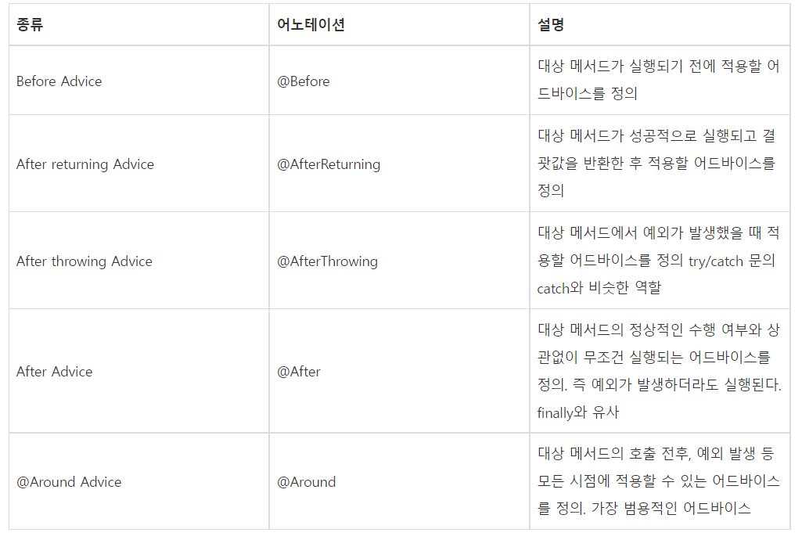

# AOP의 이해

> 작성: 2022-01-14 · 태그: Spring · [노션 원본](https://app.notion.com/p/ea856c2e16b44755b6b237b543ba73cb)

### AOP란?

AOP는 애플리케이션 전반에서 사용되는 기능을 여러 코드에 쉽게 적용할 수 있도록 도와줍니다.

로그, 권한 체크, 인증, 예외처리 등은 애플리케이션의 대부분에 적용되어야 하는 기능입니다.

기존 프로그래밍에서는 공통적으로 사용하는 기능을 하나의 클래스로 만들어 놓더라도 해당 기능이 필요한 모든 부분에서 클래스를 생성하고 필요한 메서드를 호출해야만 했습니다.

어떠한 공통 기능을 사용해야 할 부분이 백 군데라고 하면, 백 군데의 코드에 직접 공통 기능을 추가해야 했습니다.

기능에 공통적으로 들어가야 하는 기능이 있습니다. 권한 체크, 로그, 트랜잭션 등입니다. 계정이나 게시판, 계좌이체와 같은 기능을 개발하면서 직접 공통 기능을 넣어줘야 합니다.

AOP는 이러한 문제를 **관점**이라는 개념을 통해서 해결하는 방법입니다. 계정, 게시판, 계좌이체라는 핵심 기능이 관점에서는 권한, 로깅, 트랜잭션 등의 부가 기능 사이에 공통점이 없습니다. 이걸 바라보는 시점을 바꿔서 부가 기능의 관점에서 이해합니다. **부가 기능이 적용될 기점**, 즉 **<ins>핵심 로직의 시작이나 종료 시점에 그곳에서 필요한 부가 기능이 적용되기만 하면</ins>** 됩니다.

### 어드바이스

어드바이스는 관점의 구현체로 조인포인트에 삽입되어 동작하는 것을 의미합니다. 스프링에서 어드바이스는 동작하는 시점에 따라 다섯 종류로 구분됩니다.

### 포인트컷

어드바이스를 적용할 조인포인트를 선별하는 과정이나 그 기능을 정의한 모듈을 의미합니다. 정규표현식이나 AspectJ의 문법을 이용해서 어떤 조인포인트를 사용할 것인지 결정합니다. 포인트것을 표현할 수 있는 명시자에는 여러 종류가 있지만 일반적으로 가장 많이 사용하는 명시자는 execution입니다.

- execution

가장 대표적이고 강력한 지시자로 접근 제어자, 리턴 타입, 타입 패턴, 메서드, 파라미터 타입, 예외 타입 등을 조합해 가장 정교한 포인트컷을 만들 수 있습니다.

execution을 이용해서 포인트컷 표현식을 설정할 때 사용하는 표현이 있습니다. \*는 모든 값이라는 의미를 표현합니다. 예를 들어 메서드 이름을 select\*로 표현하면 select로 시작하는 모든 메서드가 선택됩니다. ..은 0개 이상이라는 의미를 표현합니다. 0개 이상은 파라미터, 메서드, 패키지 등 모든 것을 의미합니다. 패키지 구조를 표현하면 하위의 모든 패키지를 의미하고 파라미터를 표현할 때에는 파라미터 개수와 관계없이 모든 파라미터를 의미합니다.

execution(void get\*(..)) - 리턴 타입이 void이고 메서드 이름이 get으로 시작하며, 파라미터가 0개 이상인 모든 메서드가 호출될 때

execution(\* service.Impl\*()) - service 패키지 밑에 파라미터가 없는 모든 메서드가 호출될 때

execution(\* service.Impl\*(..)) - service 패키지 밑에 파라미터가 0개 이상인 모든 메서드가 호출될 때

execution(\* service..get\*(\*)) - service 패키지 모든 하위 패키지에 있는 select로 시작하고 파라미터가 한개인 모든 메서드가 호출될 때

execution(\* service..get\*(\*, \*)) - service 패키지 모든 하위 패키지에 있는 select로 시작하고 파라미터가 두개인 모든 메서드가 호출될 때

execution 포인트컷 표현식은 AOP의 핵심입니다. 꼭 이해해야 합니다.

- within

특정 타입에 속하는 메서드를 포인트컷으로 설정합니다.

within(service.Impl) - service 패키지 밑에 있는 Impl 클래스의 메서드가 호출될 때

within(service.\*Impl) - service 패키지 밑에 있는 Impl 이라는 이름으로 끝나는 메서드가 호출될 때

- bean

스프링의 빈 이름의 패턴으로 포인트컷을 설정합니다.

bean(Impl) - Impl라는 이름을 가진 빈의 메서드가 호출될 때
