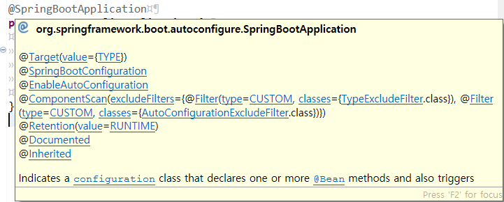

# Bean과 Component의 차이

> 작성: 2022-01-14 · 태그: Spring · [노션 원본](https://app.notion.com/p/882c71ebd08646e1b3b98ee4fc414483)

스프링이 개발자 대신 객체를 제어하기 위해서는 객체들이 빈(Bean)으로 등록되어 있어야 한다.

과거에는 객체를 빈으로 등록하기 위해 XML로 지정했어야 한다고 하는데, 요즘엔 어노테이션으로 간단하게 등록할 수가 있다.

스프링 MVC에서는 @Controller, @Service, @Repository등으로 빈으로 등록할 수 있으며, configuration 관련 객체들은 @Bean 과 @Component으로 스프링 컨테이너에 객체를 빈으로 등록할 수 있다.

- @Bean은 **메소드에서 선언**하며, 반환되는 객체(인스턴스)를 개발자가 수동으로 빈으로 등록하는 어노테이션이다. 개발자가 **컨트롤이 불가능한 외부 라이브러리 사용시** 사용한다.
- @Component는 **클래스에서 선언**함으로써 스프링이 런타임시에 컴포넌트스캔을 하여 자동으로 빈을 찾고(detect) 등록하는 어노테이션이다. 개발자가 **직접 컨트롤이 가능한** 내부 클래스에 사용한다.

@SpringBootApplication의 ComponentScan

출처 : [https://jojoldu.tistory.com/27](https://jojoldu.tistory.com/27) 기억보단 기록을
