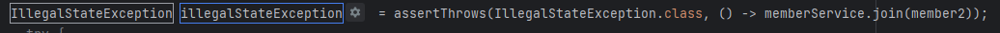

# INTELLIJ 단축키 정리

- Extract Method 기능(메소드를 따로 빼주는 기능) - CTRL+ALT+H
- Import - ALT+ENTER
- 최근에 사용했던 파일 목록 - CTRL+E
- 이클립스 F3( 타고 들어가는 거) - CTRL+B
- 현재 구문 완성 - CTRL+SHIFT+ENTER
- 테스트 케이스 작성 - CTRL+SHIFT+T
- 줄 이동 - **Alt +Shift+↑/↓**
- 줄 복사 - Ctrl+ D
- 변수 추출하기 -  CTRL+ALT+V

- 이전에 실행한 것 실행 - SHIFT + F10
