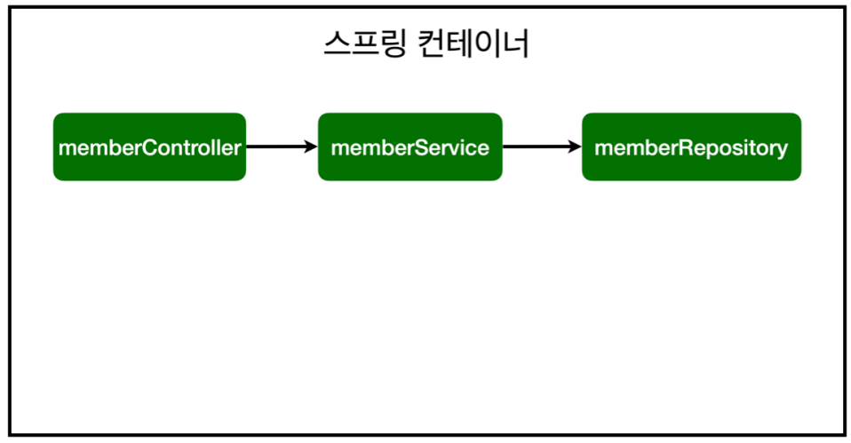
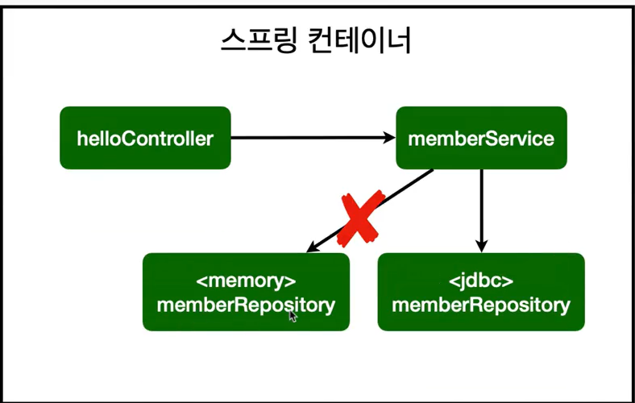

# Spring boot 기초 복습 김영한 인프런 3 - BEAN

> 작성: 2023-07-03 · 태그: Spring · [노션 원본](https://app.notion.com/p/90224cab503247f89546c3895f21c2d5)

## Spring Bean과 의존성 주입

### 컴포넌트 스캔의 원리

@Component 애노테이션이 있으면 스프링 빈으로 자동 등록된다.<br>@Controller 컨트롤러가 스프링 빈으로 자동 등록된 이유도 컴포넌트 스캔 때문이다.<br>@Component 를 포함하는 다음 애노테이션도 스프링 빈으로 자동 등록된다.

- @Controller
- @Service
- @Repository

참고: 생성자에 @Autowired 를 사용하면 객체 생성 시점에 스프링 컨테이너에서 해당 스프링 빈을 찾아서 주입한다. 생성자가 1개만 있으면 @Autowired 는 생략할 수 있다.



```java
@Controller // Spring이 뜰 때, 이 객체를 생성하도록하는 어노테이션 -> 이를 스프링 컨테이너에서 빈이 관리된다 표현
public class MemberController {

    private final MemberService memberService;

    @Autowired  //스프링 컨테이너에서 매칭시켜주는 어노테이션 -> 의존관계 주입 DI
    public MemberController(MemberService memberService) {
        this.memberService = memberService;
    }
}
```

1. 위의 코드에 멤버 컨트롤러의 생성자에 @Autowired를 통해 컨테이너에 등록된 빈을 주입시키면

```java
@Service
public class MemberService {

    private final MemberRepository memberRepository;
    //memberRepository는 전역적으로 같이 쓰는 객체기 때문에 새롭게 생성하지않고 기존에 생성된 memberRepository를 주입하여 사용한다.
    @Autowired
    public MemberService(MemberRepository memberRepository) {
        this.memberRepository = memberRepository;
    }
```

2. memberService에 Service Bean으로 등록시킨 memberRepository가 들어오게 되는 것 !

> 참고: 스프링은 스프링 컨테이너에 스프링 빈을 등록할 때, 기본으로 싱글톤으로 등록한다(유일하게 하나만 등록해서 공유한다) <br>따라서 같은 스프링 빈이면 모두 같은 인스턴스다. 설정으로 싱글톤이 아니게 설정할 수 있지만, 특별한 경우를 제외하면 대부분 싱글톤을 사용한다.

> 참고: DI에는 필드 주입, setter 주입, 생성자 주입 이렇게 3가지 방법이 있다. 의존관계가 실행중에 **동적**으로 변하는 경우는 거의 없으므로 **생성자 주입을 권장**한다.<br>**→ 동적으로 변한다는 의미는 서버에서 서비스가 실행중인데 서비스를 수정하는 경우를 뜻함**

> 참고: 실무에서는 주로 정형화된 컨트롤러, 서비스, 리포지토리 같은 코드는 컴포넌트 스캔을 사용한다.<br>그리고 정형화 되지 않거나, 상황에 따라 구현 클래스를 변경해야 하면 설정을 통해 스프링 빈으로 등록한다. → 지금처럼 **메모리에서 DB로 변경**할 때, 다른 클래스에 손대지않고 config만 수정하면 되기때문에 특정 경우에 편리하다.

> 주의: @Autowired 를 통한 DI는 helloController , memberService 등과 같이 스프링이 관리하는<br>객체에서만 동작한다. 스프링 빈으로 등록하지 않고 내가 직접 생성한 객체에서는 동작하지 않는다.

## 다형성 활용

```java
@Configuration
public class SpringConfig {

    private DataSource dataSource;

    @Autowired
    public SpringConfig(DataSource dataSource){
        this.dataSource = dataSource;
    }

    @Bean
    public MemberService memberService(){
        return new MemberService(memberRepository());
    }

    @Bean
    public MemberRepository memberRepository(){
       // return new MemoryMemberRepository();
        return new JdbcMemberRepository(dataSource);
    }
}
```

이전에 작성했던 SpringConfig는 DB대신 메모리를 사용했는데, H2 DB를 등록하고 기존 소스의 변경된 모습이다.

기존 소스에 영향도를 최소화하고 사용할 JdbcMemberRepository만 생성하고 Config에서 이 부분만 손대면

변경이 완료되는 것을 확인할 수 있다.



- 개방-폐쇄 원칙(OCP, Open-Closed Principle)

  - 확장에는 열려있고, 수정, 변경에는 닫혀있다.
- 스프링의 DI(Dependencies Injection)을 사용하면 **기존 코드를 전혀 손대지 않고, 설정만으로 구현 클래스를 변경**할 수 있다.

### @SpringBootTest / @Transactional

```java
@SpringBootTest //스프링 컨테이너와 테스트를 함께 실행한다.
@Transactional  /*테스트 케이스에 이 애노테이션이 있으면, 테스트 시작 전에 트랜잭션을 시작하고,
							   	테스트 완료 후에 항상 롤백한다. 이렇게 하면 DB에 데이터가 남지 않으므로
								  다음 테스트에 영향을 주지 않는다.*/
class MemberServiceIntegrationTest {
```

테스트 진행시에 @Transactional 어노테이션을 붙이면 <br>DB에 반영이 안되고 Rollback해줘서 재 테스트를 볼때 편리하게 할 수 있다. (테스트 데이터가 안들어가게 막아줌)
