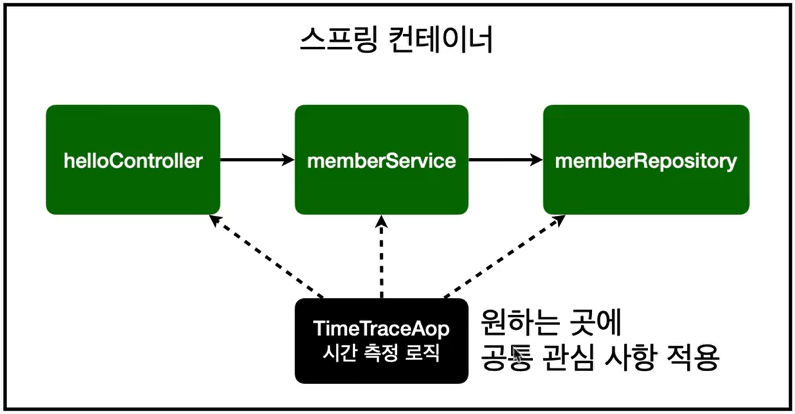

# Spring boot 기초 복습 김영한 인프런  5 - AOP

## AOP(Aspect Oriented Programming - 관점지향프로그래밍)

: 공통 관심 사항과 핵심 관심 사항으로 분리해서 보는 것

이게 무슨 말인가하면 예를 들어보겠다.

프로젝트 전체의 모든 메소드의 동작시간을 체크해야한다고 할때, 이 부분은 공통관심사항이 되겠다.

그 외 회원가입, ID 중복체크 등 이런 각 메소드 고유의 기능은 핵심 관심 사항이다.

→ 여기서 공통 관심사항을 처리하기 좋은 것이 AOP이다.



```java
@Aspect
@Component
public class TimeTraceAop {

    @Around("execution(* hello.hellospring..*(..))")       //범위 적용
    public Object execut(ProceedingJoinPoint joinPoint) throws Throwable{
        long start =System.currentTimeMillis();
        System.out.println("START : " + joinPoint.toString());
        try{
            return joinPoint.proceed();
        } finally {
            long finish =System.currentTimeMillis();
            long timeMs = finish-start;
            System.out.println("END = " + joinPoint.toString()+ " " + timeMs + "ms");
        }

    }
}
```

<code>@Aspect</code> Annotation의 경우 해당 Class가 횡단관심사(부가기능) Class임을 알려주는 Annotation입니다. <code>@Aspect</code>Annotation이 부여되었다고 해서 자동으로 Bean으로 등록되는것이 아니므로 따로 Bean으로 등록을 해주는 작업이 필요합니다. 물론 @Component등의 Annotation을 이용해도 됩니다.

<code>@Around</code> Annotation의 경우 앞선 포스팅에서 살펴보았듯이 <code>Advice</code>한 종류로 <code>핵심관심사</code>의 실패여부와 상관없이 전 후로 실행되도록 하는 <code>Advice</code>입니다. <code>@Around</code> Annotation의 속성값으로 <code>PointCut</code>을 전달해주어야 합니다.
