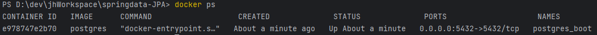

# JPA 핵심개념이해 - JPA 사용 이유

> 작성: 2023-07-16 · 태그: Spring, JPA · [노션 원본](https://app.notion.com/p/d9a659c1f5a0432cae28319e9bc5d7e1)

## docker 설정

```shell
docker run -p 5432:5432 -e POSTGRES_PASSWORD=pass -e POSTGRES_USER=jin -e
POSTGRES_DB=springdata --name postgres_boot -d postgres
```



```shell
docker exec -i -t postgres_boot bash
* -i 는 Interactive mode , -t 는 어떤 컨테이너에 명령어를 실행할지 타겟설정 , 내가 실행할 명령어는 bash
```

```shell
psql --username jin --dbname springdata
* windows 환경이기 때문에 username을 명시해줘야 오류가 발생하지 않는다.
```

### JDBC의 불편함

```java
public class Application {
    public static void main(String[] args) {
        String url = "jdbc:postgresql://localhost:5432/springdata";
        String username = "jin";
        String password = "pass";

        try(Connection connection = DriverManager.getConnection(url, username, password)){
            System.out.println("Connection created : " + connection);
            //String sql = "CREATE TABLE ACCOUNT(id int, username varchar(255), password varchar(255))";
            String sql = "INSERT INTO ACCOUNT VALUES(1, 'jin', 'pass')";
            try(PreparedStatement statement= connection.prepareStatement(sql)){
                statement.execute();
            }
        } catch (SQLException e) {
            throw new RuntimeException(e);
        }
    }
}
```

- try**(Connection connection = DriverManager.getConnection(url, username, password))**\{\}<br>: Java 7 버전 이전에는 다 사용하고 난 자원(resource)을 반납하기 위해서 try-catch-finally 구문을 사용했었음<br>Java 7버전 이후에 추가된 **try with resources** 기능은 try 구문에 리소스를 선언하고,<br>**리소스를 다 사용하고 나면 자동으로 반납(close) 해주는 기능을 제공**함.
- 위의 코드에서 볼 수 있는 JDBC 단점

  - Connection 객체는 아무때나 막 생성하기엔 부담스러운 객체다…
  - DB마다 SQL문이 다른데 그때마다 변경해야한다…
  - 반복적인 코드가 많음…

→ 그렇기때문에 ORM을 써야한다 !

### JPA ORM의 특징

: ORM은 애플리케이션의 클래스와 SQL 데이터베이스의 테이블 사이의 **맵핑 정보를 기술한 메타데이터**를 사용하여, 자바 애플리케이션의 객체를 SQL 데이터베이스의 테이블에 **자동으로 영속화(JVM외부에서도 살아있을 수 있도록)** 해주는 기술입니다.

- JPA에서 성능은 물론 JPA는 하이버네이트를 거쳐서 날아가기 때문에 사용자가 직접 짠 쿼리를 날리는 것이 더 빠르긴 하다. (마치 C가 JAVA보다 빠르다 하는 느낌)

  -  하지만 JPA는 객체와 DB사이에 캐시가 존재하고 **한 트랜잭션 내에서** DB가 바뀌어야하는 상황을 감지하여 그때만 쿼리를 날린다.

    - → 예시로 ACCOUNT라는 객체에 비밀번호를 사용자가 세번 변경을 요청했지만, 첫번째와 마지막 세번째가 같은 비밀번호라면 쿼리는 실제로 한번만 날아간다. 왜? 캐시가 있기때문에<br>\* 이러한 관점에서는 JPA가 더 좋은 성능을 가지고 있다고 볼 수 있다.
- 하이버네이트를 사용해서 성능이 나빠진다?

  - 아니다. 하이버네이트를 잘 학습해서 사용하면 성능과는 관계없이 사용할 수 있다. <br>→ 하이버네이트의 밑단에는 JDBC가 있기때문에 얼마든지 하이버네이트의 자동생성 쿼리가 아니라<br>사용자가 직접 쿼리를 날릴 수 있기때문에..
