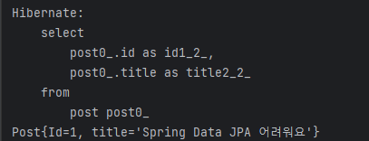

# JPA 핵심개념이해 - Fetch & Query

## ✨ Fetch

: 연관 관계에 있는 **엔티티를** **언제 가져올지 설정**하는것 - 지금 **Eager** \| 나중에 : **Lazy**

- @OneToMany 기본값 Lazy
- @ManyToOne 기본값 Eager

→ 무슨말이냐하면 Post와 Comment 엔티티가 있다고 가정했을 때, <br>   Post(게시글)을 불렀을 때, 지금 당장 Comment 정보까지 사용할건지에 대한 이야기이다.<br>  게시글을 불러오면서 화면에 Comment를 바로 뿌려야한다면 지금(Eager) 당장 가져오는 것이 좋고 (두번 Select할 필요없으니) 댓글창 열기 라는 기능이 있어서 당장 불러올 필요가 없다면 나중에(Lazy)가 맞다는 이야기

### ⭐ Query 작성 방식

- **JPQL (HQL)**
  - Java Persistence Query Language / Hibernate Query Language
  - 데이터베이스 테이블이 아닌, 엔티티 객체 모델 기반으로 쿼리를 작성한다.
  - JPA 또는 하이버네이트가 해당 쿼리를 SQL로 변환해서 실행한다.

    - EX) SELECT p FROM Post AS p

  ```java
  
      @Override
      public void run(ApplicationArguments args) throws  Exception{
          //Type을 지정해주고 쿼리를 짤 수 있음
          TypedQuery<Post> query = entityManager.createQuery("SELECT p FROM Post As p", Post.class);
          List<Post> posts = query.getResultList();
          posts.forEach(System.out::println); //Post 클래스에 toString 메소드를 만들어 놨기 때문에 주소값이 아닌 텍스트로 콘솔에 표출
  ```

  

  Post 테이블의 값을 잘 가져오는 것을 확인할 수 있다.

  
- **Criteria**
  - 타임 세이프 쿼리
  - 문자열이 들어가지 않아서 오타를 방지할 수 있다.

  ```java
  
      @Override
      public void run(ApplicationArguments args) throws  Exception{
          CriteriaBuilder builder = entityManager.getCriteriaBuilder();
          CriteriaQuery<Post> query = builder.createQuery(Post.class);
          Root<Post> root = query.from(Post.class);
          query.select(root);
  
          List<Post> posts = entityManager.createQuery(query).getResultList();
          posts.forEach(System.out::println);
  ```

  결과는 같다.

- **Native Query**
  - 평소에 사용하던 SQL로 작성하는 기법

  ```java
  		@Override
      public void run(ApplicationArguments args) throws  Exception{
          List<Post> posts= entityManager.createNativeQuery("Select * from Post", Post.class).getResultList();
          posts.forEach(System.out::println);
  ```

  결과는 같다.
