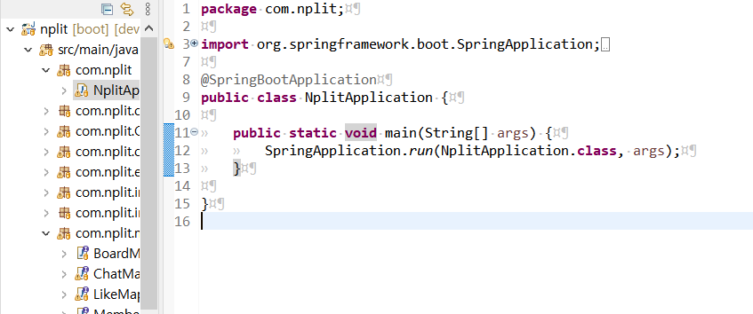

# SpringBootApplication

- Application 클래스는 **프로젝트의 메인 클래스**이다.
- **@SpringBootApplication**으로 인해 스프링 부트의 자동설정, 스프링 Bean 읽기와 생성을 모두 자동으로 설정된다.
- **@SpringBootApplication**이 있는 위치부터 설정을 읽어가기 때문에 이 클래스는 **항상 프로젝트의 최상단**에 위치해야한다.
- main 메소드에서 실행하는 **SpringApplication.run으로 인해 내장 WAS(Web Application Server)를 실행**한다.
- 내장 WAS란 별도로 외부에 WAS를 두지 않고 애플리케이션을 실행할 때 **내부에서 WAS를 실행하는 것을 이야기한다. 이렇게 되면 항상 서버에 톰캣을 설치할 필요가 없게 되고, 스프링 부트로 만들어진 Jar파일(실행 가능한 JAVA zip 파일)로 실행**하면 된다.
