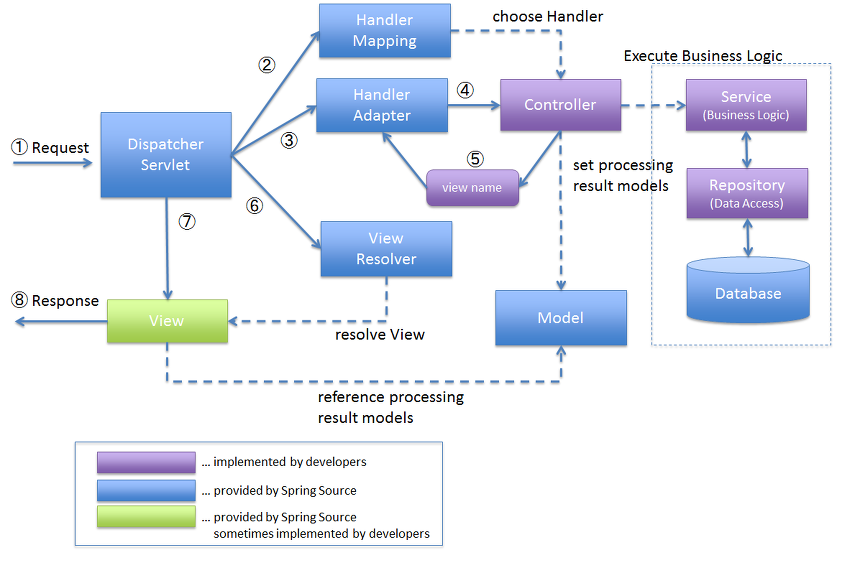

# Spring MVC구조의 처리과정

**1. DispatcherServlet**

: 애플리케이션으로 들어오는 모든 Request를 받는 부분. Request를 실제로 처리할 Controller에게 전달하고 그 결과값을 받아서 View에 전달하여 적절한 응답을 생성할 수 있도록 흐름을 제어

**2. HandlerMapping**

: Request URL에 따라 각각 어떤 Controller가 실제로 처리할 것인지 찾아주는 역할

**3. Controller**

: Request를 직접 처리한 후 그 결과를 다시 DispatcherServelt에 돌려주는 역할

**4. ModelAndView**

: Controller가 처리한 결과와 그 결과를 보여줄 View에 관한 정보를 담고 있는 객체

**5. ViewResolver**

: View 관련 정보를 갖고 실제 View를 찾아주는 역할

**6. View**

: Controller가 처리한 결과값을 보여줄 View를 생성
