# Spring boot 기초 복습 김영한 인프런 1 -SETTING

## 스프링 부트 라이브러리

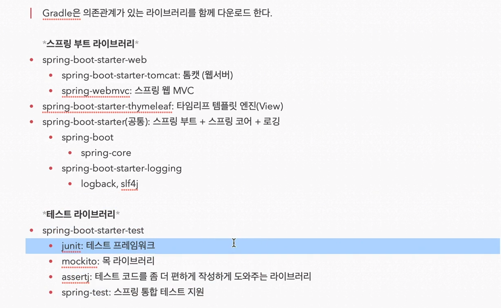

### 스프링 부트 컨트롤러

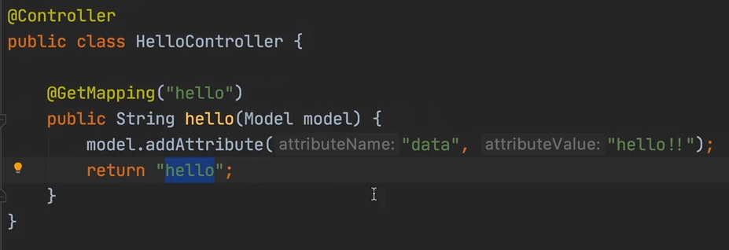

 return “hello”라 함은 templates의 hello파일을 찾아서 보여줘라 라는 뜻으로 부트에서 쓰인다. → 컨트롤러에서 return값으로 문자를 반환하면 viewResolver가  화면을 찾아서 처리하도록 되어있음.      resources:templates/ + \{ViewName\}+.html  형태로 매핑되어 있음.

### 빌드

**windows**는 Workspace내의 gradlew.bat, **Mac**은 gradlew를 cmd에서 파일명+공백+build 입력 시 실행가능한 파일을

Workspace/build/libs에 만들어준다. 이 파일을 java -jar 파일명으로 실행시키면 intelij가 아닌 환경에서 실행이 가능하다. 

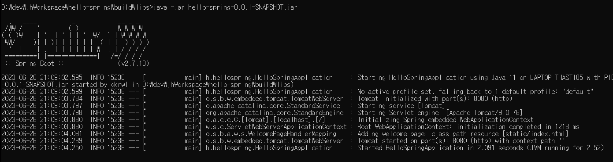

이렇게 실행하면 localhost의 8080포트를 이미 사용중이기 때문에 intelij에서 중복 실행할 수 없다.

 

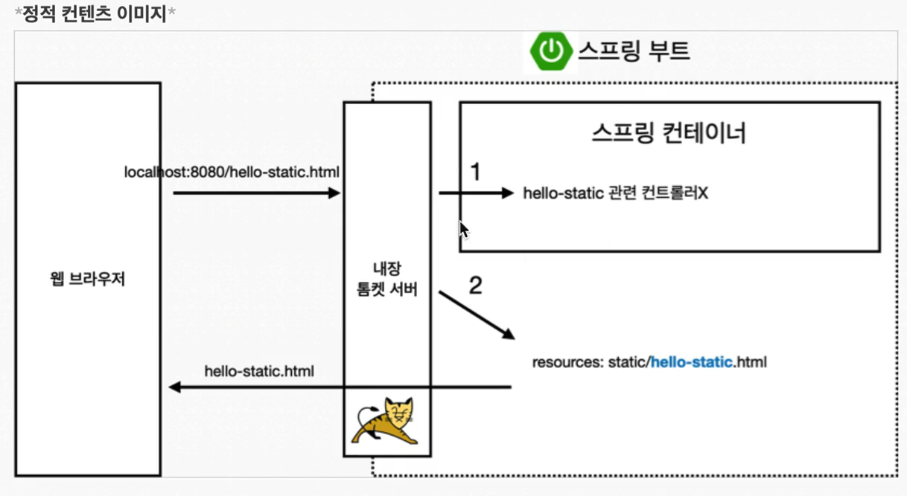

Spring에서 정적컨텐츠가 실행되는 과정  1. 웹브라우저에서 hello-static.html을 찾는다고 할때, 우선적으로 컨트롤러에 해당 매핑된 컨트롤러가 있는지 찾는다. 2. 내부의 resources의 static에서 해당 파일이 있는 지 찾아서 반환한다. 

### MVC 방식 → view 렌더링을 위한 방식 

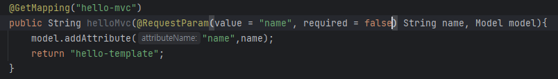

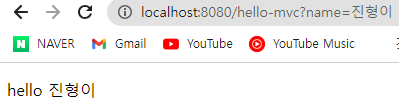

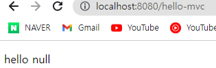

코드부터 살펴보면 파라미터 name을 받도록 되어있는데, 기존 required의 default값이 true기 때문에 파라미터를 넣지않으면 에러페이지로 간다.  → 그래서 위에 코드를 보면 required를 false로 설정해서 무조건 파라미터를 받지 않아도 되도록 false로 설정한 것을 볼 수 있다.

### API 방식 → 객체를 반환하기 위한 방식

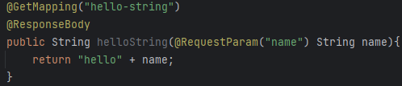

ResponseBody는 응답받는 Body부에 직접 데이터를 넣어주겠다는 의미이다.(View가 필요없다.) → 객체 반환 시 JSON으로 변환된다. 

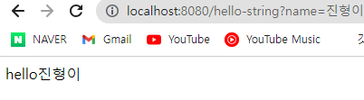

하지만 API방식은 이런식으로 VIEW를 구성하기보다는 

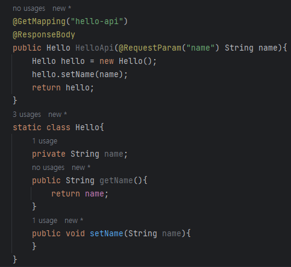

이렇게 데이터를 넘겨주기위한 형태로 많이 사용된다. 

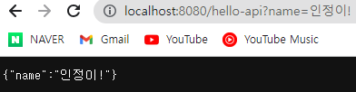

ResponseBody를 사용했기 때문에 MappingJackson2HttpMessageConverter가 동작해서 JSON (KEY,VALUE) 형태로 결과 데이터가 보여진다.

→ XML은 태그를 열고 닫기 때문에 좀더 무거워서 최근에는 JSON이 더 많이 쓰인다.
