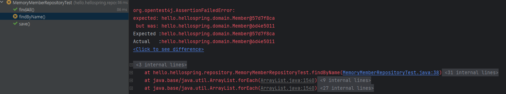
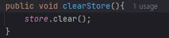
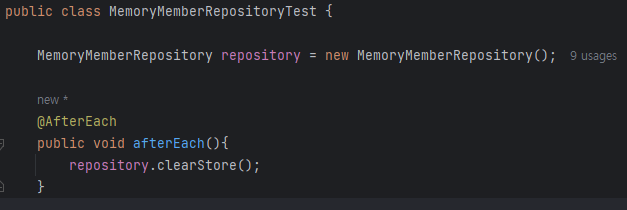
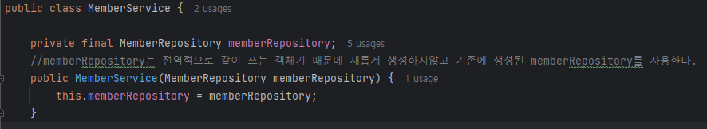

# Spring boot 기초 복습 김영한 인프런 2 - TDD

### DB 대용으로 MEMORY 코드 짜기

```java
public class MemoryMemberRepository implements MemberRepository{

    private static Map<Long, Member> store = new HashMap<>();
    private static long sequence = 0L;
    @Override
    public Member save(Member member) {
        member.setId(++sequence);
        store.put(member.getId(), member);
        return member;
    }
    @Override
    public Optional<Member> findById(Long id) {
        return Optional.ofNullable(store.get(id));
    }
    @Override
    public Optional<Member> findByName(String name) {
       return store.values().stream()
                .filter(member -> member.getName().equals(name))
                .findAny();
    }
    @Override
    public List<Member> findAll() {
        return new ArrayList<>(store.values());
    }
}
```

- Optional로 감싸면 null처리를 할 수 있다.(추가적으로 라이브러리 내의 메소드들을 사용할 수 있음)
- stream을 통해 name을 찾는 기능 추가
- 새로운 ArrayList를 생성해서 모든 Map store에 name이 담긴 리스트 반환하기

### 테스트 케이스 작성을 통해 메모리 검증

```java
public class MemoryMemberRepositoryTest {

    MemberRepository repository = new MemoryMemberRepository();

    @Test
    public void save(){
        Member member =new Member();
        member.setName("spring");

        repository.save(member);
        Member result = repository.findById(member.getId()).get();
        Assertions.assertEquals(result, member);
        assertThat(member).isEqualTo(result);
    }

    @Test
    public void findByName(){
        Member member1 = new Member();
        member1.setName("spring1");
        repository.save(member1);

        Member member2 = new Member();
        member2.setName("spring2");
        repository.save(member2);

        Member result = repository.findByName("spring2").get();

        assertThat(result).isEqualTo(member2);
    }

    @Test
    public void findAll(){
        Member member1 = new Member();
        member1.setName("spring1");
        repository.save(member1);

        Member member2 = new Member();
        member2.setName("spring2");
        repository.save(member2);

        List<Member> result = repository.findAll();

        assertThat(result.size()).isEqualTo(2);
    }
}
```

이렇게 테스트 케이스를 작성해서 각 메소드를 테스트할 수 있다.<br>테스트 실행은 클래스단위 개별 메소드단위 둘다 실행이 가능하지만, <br>메소드 실행 순서는 보장이 되지 않고 이렇게 같은 변수명으로 테스트 실행하면 데이터가 남아있기때문에<br>에러가 날 수 있다.



실제로 findAll()이 먼저 동작된 것을 확인할 수 있다.<br>→ 그렇기 때문에 테스트가 끝날때마다 메모리를 비워줘야한다.





AfterEach를 통해 테스트가 끝날 때마다 비워주도록 설정해주면 정상적으로 테스트가 진행된다.



memberRepository는 공용 객체인데 새롭게 생성해서 사용하면 메모리 공간뿐만이 아니라

다른 인스턴스라서 변경될 때, 오류가 발생할 수 있다. 그렇기때문에 외부에서 넣어주는 식으로 변경했다.
