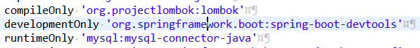
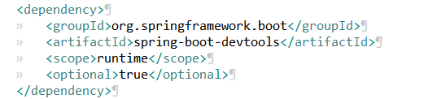
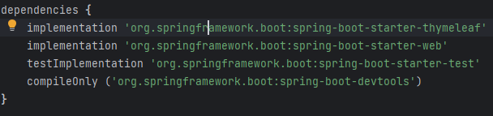

# Devtools란?

> 작성: 2024-01-13 · 태그: Spring · [노션 원본](https://app.notion.com/p/d78bf46b4ec5407b9c2d782cee7f93cf)

**devtools**는 Spring boot에서 제공하는 개발 편의를 위한 모듈

코드 수정시 브라우저에서 보여주는 내용도 수정하려면 애플리케이션을 재실행해야하는데 ,

브라우저로 전송되는 내용들에 대한 코드가 변경되면, **자동으로 애플리케이션을 재시작**하여 브라우저에도 업데이트 해주는 역할을 한다.

Gradle

Maven

## 추가로 알게된 사실 230627

devtools는 재실행없이 코드의 수정에 반응해 빌드를 자동으로 해주는 라이브러리이다.

그렇기때문에 implementation이 아닌 compileOnly로 의존성을 추가해주는데 이 두개의 차이는 implementation는 의존된 부분을 빼고 변경된 모듈에 대해서만 적용을 해주고

compileOnly는 의존된 부분까지 모두 재빌드를 해준다는 차이가 있다. 속도면에서는 implementation이 빠르지만 의존된 부분이 변경이 이뤄지지않는다면 runtime에서 오류가 발생하기 때문에 compileOnly를 통해 의존성을 추가한다.
