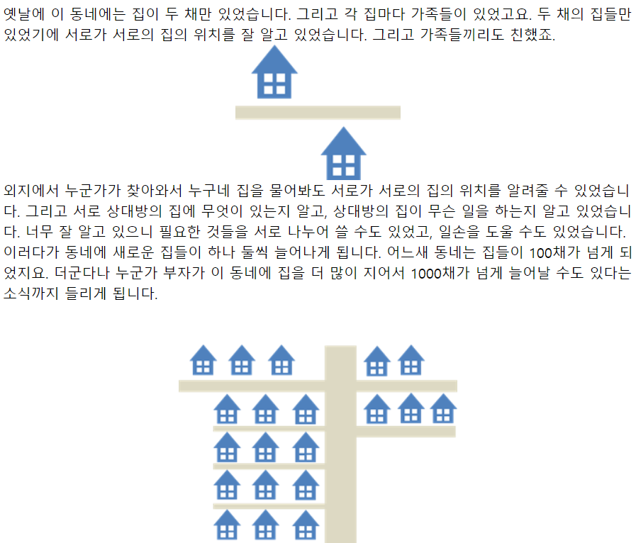
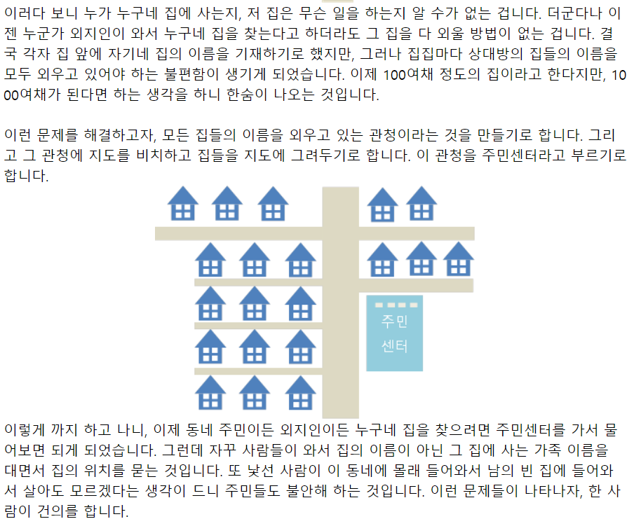

# Server와 Client

> 작성: 2024-01-13 · 태그: Spring · [노션 원본](https://app.notion.com/p/a4c8f7d94eeb4aefb570bc91cd88f477)

 

## Server

- server는 클라이언트에게 네트워크를 통해 서비스를 제공하는 시스템을 말한다.
- 우리가 일반적으로 사용하는 PC는 client역할이고, server컴퓨터로부터 정보를 받아 웹 브라우저를 통해 정보를 볼 수있다.
- 홈페이지를 제작하거나 웹 어플리케이션을 만들 때 기획자가 의도에 맞는 데이터를 자신의 서버에 넣고 고객들의 요청에 맞게 전달한다.
- 이렇게 서버를 통해 인터넷 웹 페이지에서 정보를 제공할 수 있다.

⇒ 클라이언트의 요청에 따라 클라이언트에게 서비스를 제공하는 시스템 또는 프로그램은 서버

## Client

- 클라이언트는 단어의 뜻으로 보면 ‘고객’이다.
- 이는 서버와 서로 대응되는 개념이며, 서비스를 사용하는 사용자를 의미한다.

⇒ 웹을 통해 서비스를 요청하는 컴퓨터 또는 프로그램은 클라이언트

###   개념 이해를 돕기 위한 좋은 예시

Reperence :[https://m.blog.naver.com/PostView.naver?isHttpsRedirect=true&blogId=arrowmask&logNo=220948293885](https://m.blog.naver.com/PostView.naver?isHttpsRedirect=true&blogId=arrowmask&logNo=220948293885)

[https://codacoding.tistory.com/17](https://codacoding.tistory.com/17)
