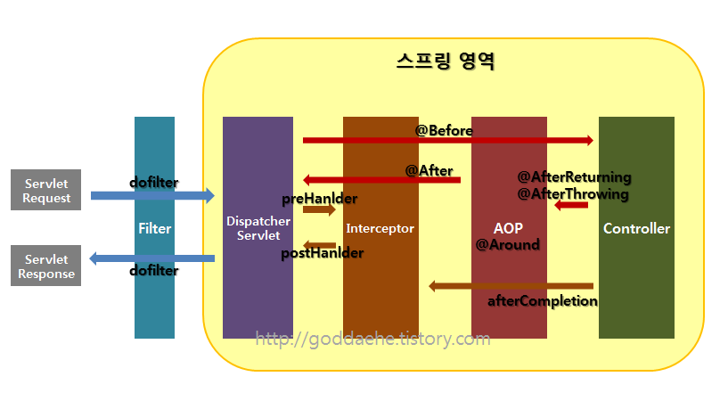

# 인터셉터

### 인터셉터란 ?

특정 URI로 요청시 Controller로 가는 요청을 가로채는 역할을 한다.

### 인터셉터와 JSP Filter의 차이

- **공통점**은 둘다 Controller로 들어가는 요청을 가로채서 작업하는 용도
- **차이점**은 영역이 다르다.

사진을 보면 필터가 가장 외곽 인터셉터, AOP, Controller 순인 것을 볼 수 있다.

따라서 요청이 들어오면 Filter → Intercepter → AOP → Interceptor → Filter순으로 거치게 된다.

-Filter는 같은 웹 어플리케이션 내에서 접근이 가능하다 → 주로 **한글처리**에 이용

-Interceptor는 스프링에서 관리되기 때문에 스프링 내의 모든 객체에 접근이 가능하다. →주로 **로그인 처리**에 이용

### 인터셉터를 지원하기 위한 인터페이스, 클래스, 메서드

Spring에서 인터셉터를 지원하기 위해서

-**HandlerInterceptor 인터페이스**

-**HandlerInterceptorAdapter 추상 클래스를 지원한다.**

**HandlerInterceptorAdapter 는 3가지 메서드를 제공하는데, 이를 오버라이딩해서 우리가 사용한다.**

1**)preHandle**(HttpServletRequest request, HttpServletResponse response, Object handler)

:**<ins> Controller로 요청이 들어가기 전</ins>**에 수행된다.

: 매개변수는 HttpServletRequest, HttpServletResponse와 나머지 하나는 이 preHandle() 메서드를 수행하고 수행될 컨트롤러 메서드에 대한 정보를 담고 있는 handler이다.

2\) **postHandle**(HttpServletRequest request, HttpServletResponse response, Object handler, ModelAndView modelAndView)

: 컨트롤러의 메서드의 처리가 끝나 return 되고 **<ins>화면을 띄워주는 처리가 되기 직전에</ins>** 이 메서드가 수행된다.

: ModelAndView 객체에 컨트롤러에서 전달해 온 Model 객체가 전달됨으로 컨트롤러에서 작업 후

: postHandle() 에서 작업할 것이 있다면 ModelAndView를 이용하면 된다.

3\) **afterCompletion()**

: 컨트롤러가 수행되고 **<ins>화면처리까지 끝난 뒤</ins>** 호출된다.

### 만들어 보기(자동로그인 부분 참고)

[bookmark: https://www.notion.so/secretj/N-PLIT-39186b6c4d714dadad25851251ed3563](https://www.notion.so/secretj/N-PLIT-39186b6c4d714dadad25851251ed3563)

출처:

[https://rongscodinghistory.tistory.com/2](https://rongscodinghistory.tistory.com/2)

\[악덕고용주의 개발 일기\]
