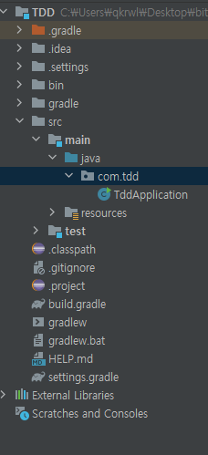
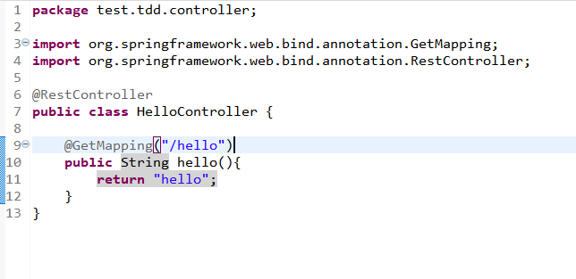
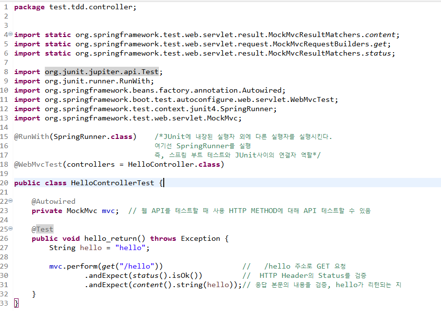
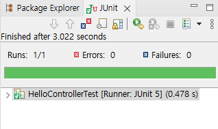

# 테스트 코드(TDD)

> 작성: 2024-01-13 · 태그: Spring · [노션 원본](https://app.notion.com/p/a071ab3b61de4aeea35a63f7a4285e82)

## TDD란?

작성 종료조건을 먼저 정해놓고 코딩을 시작하는 것

- RED : 항상 실패하는 테스트를 먼저 작성
- GREEN : 테스트에 통과하는 프로덕션 코드 작성
- REFACTOR : 테스트가 통과하면 프로덕션 코드를 리팩토링

레드 그린 사이클을 작성하고 반복해서 제대로 동작하는지에 대한 피드백을 적극적으로 받는 것

## TDD 사용이유

- 개발 초기에 문제를 발견하게 해줌
- 추후에 코드를 리팩토링하거나 라이브러리 업그레이드 등에서 기존 기능이 올바르게 작동하는 지 확인할 수 있음
- 기능에 대한 불확실성을 감소시켜줌

## 실습

1. TDD 프로젝트 gradle로 생성

2. HelloController 생성

3. HelloControllerTest 생성

4. JUnit으로 실행하면 제대로 실행되는 지 확인할 수 있다.

