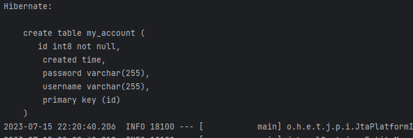
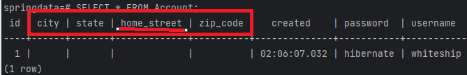
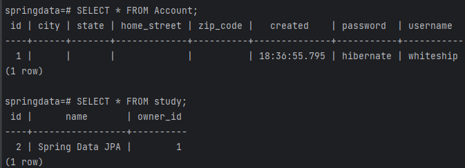
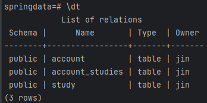
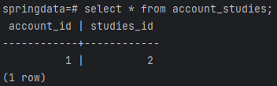
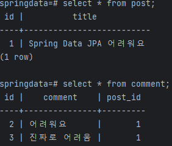

# JPA 핵심개념이해 - 맵핑과 상태

> 작성: 2024-02-13 · 태그: Spring, JPA · [노션 원본](https://app.notion.com/p/ba3605a7b4f645ccae8c141c6242366a)

## ✨엔티티 맵핑

```cs
spring.datasource.url=jdbc:postgresql://localhost:5432/springdata
spring.datasource.username=jin
spring.datasource.password=pass

# 개발할때는 create 혹은 update 운영시에는 validate
spring.jpa.hibernate.ddl-auto=create
spring.jpa.properties.hibernate.jdbc.lob.non_contextual_creation=true

spring.jpa.show-sql=true
spring.jpa.properties.hibernate.format_sql=true
```

**ddl-auto 설정**

- **create** : 서비스를 껏다가 키면 기존 데이터가 삭제되고 새로 맵핑되어 생성된다.
- **update** : 껏다가 실행해도 기존 데이터가 유지된다.<br>※ 주의 : 이전에 생성했던 컬럼의 정보를 변경하여 실행하면 임밸리드 에러가 발생
- **validate** : 엔티티 컬럼들이 릴레이션과 잘 맵핑되어 있는지 검증하고 실행한다.

**show-sql 및 format 설정**

- 콘솔창에 쿼리가 날아가는 과정이 눈으로 보이게하여 어떤 상황인지 개발자가 파악하기 쉽도록 하는 설정
- format을 sql로 설정하여 좀 더 알아보기 쉽게 변경할 수 있다.



```java
@Entity(name = "myAccount")
@Table
public class Account {
    @Id @GeneratedValue
    private Long id;

    private String username;

    private String password;

		@Temporal(TemporalType.TIME)
    private Date created = new Date();
```

@**Entity**(name = “myAccount”)

- 엔티티란 <ins>객체 세상에서 부르는 이름</ins>을 말한다.
- 보통 클래스와 같은 이름을 사용하기 때문에 값을 변경하지 않는다.

\*참고 : 하이버네이트에서 User라는 키워드를 사용중이기때문에 User클래스를 생성하여 쓰고싶으면 엔티티명(및 테이블명)을 변경해서 사용해야한다.

@**Table**  

- <ins>릴레이션 세상에서 부르는 이름</ins>을 말한다.
- <ins>기본값은 Entity</ins>로 설정되어 따로 이름을 정의하지않으면 엔티티와 같은 이름을 사용한다.

@**Id**

- 엔티티의 주키를 맵핑 (랩퍼 타입을 쓰는게 새로만든 레코드랑 구분하기가 쉽다.)

@**GeneratedValue**

- 자동생성된 값을 쓰겠다. → DB에 따라 다름 시퀀스, 아이덴티티 컬럼 등
- 명시적으로 쓸 수도 있음.

  - GeneratedValue(strategy = GenerationType.SEQUENCE) 이런식으로 …

**@Column**

- 모든 멤버 변수에는 Column이 생략되어 있음.
- nullable=false 설정이나 unique = true등 설정이 가능함

**@Temporal**

- 시간관련된 멤버변수 옵션

**@Transient**

- 컬럼으로 맵핑하고 싶지 않은 변수에 사용

### ⭐Value 타입 맵핑

: 다른 엔티티에 **종속적인** 타입이다.(다른 엔티티를 참조하여 사용하는 타입)

- Composite Value 타입

```java
/**
* Address 클래스 생성
**/
@Embeddable
public class Address {
    private String street;
    private String city;
    private String state;
    private String zipCode;
}

/**
* Account 클래스
**/
@Embedded
    @AttributeOverrides({
            @AttributeOverride(name="street", column = @Column(name="home_street"))
    })
    private Address Address;
```

위의 코드를 추가하고 변화된 DB를 살펴보면 아래와 같다.



Account 테이블에 Address의 멤버변수들이 컬럼으로 추가된 것을 확인할 수 있다.

이때 사용되는 어노테이션은 @Embedded / @Embeddable

추가적으로 Value타입을 추가할때, 컬럼을 변경하여 사용하고 싶다면 @AttributeOverrides 를 통해 여러개의 멤버변수를 다른 컬럼이름으로 변경하여 사용할 수 있는 것을 확인할 수 있다.

### ⭐관계 맵핑

- 단방향 관계

**@ManyToOne**

: FK 생성



**@OneToMany**

```java
//Account
@OneToMany
private Set<Study> studies = new HashSet<>();

//JpaRunner
account.getStudies().add(study);
```

받는 쪽이 여러개를 받아야하기때문에 자료구조로 받아야함.

실행하면 Join을 통해 새로운 테이블을 구성하게된다.(총 3개 : Account, Study, account\_studies )





- 양방향 관계

: 양방향 관계를 설정할때에는 OneToMany측에 mappedBy 설정을 해줘야한다.<br>→ 그래야 중복된 데이터를 만들지 않는다 !

```java
//JpaRunner
account.addStudy(study);

//Account
public void addStudy(Study study){
        this.getStudies().add(study);
        study.setOwner(this);
    }
```

양방향 관계기 때문에 서로간의 레퍼런스를 서로가 가지고 있어야한다 !! → 안그러면 관계 데이터가 안쌓임

### ⭐Cascade

: 엔티티의 상태 변화를 전파 시키는 옵션

- 엔티티의 상태
  - Transient : JPA가 모르는 상태
  - Persistent : JPA가 관리중인 상태 → 트랜잭션이 끝나기 이전 상태
  - Detached : JPA가 더이상 관리하지 않는 상태
  - Removed : JPA가 관리하긴 하지만 삭제하기로 한 상태

  ```java
  			//Post Class
  				@OneToMany(mappedBy = "post", cascade = CascadeType.ALL)
  				private Set<Comment> comments = new HashSet<>();
  
  			//JpaRunner Class
  				Post post = new Post();
          post.setTitle("Spring Data JPA 어려워요");
  
          Comment comment = new Comment();
          comment.setComment("어려워요");
          post.addComment(comment);
  
          Comment comment1 =new Comment();
          comment1.setComment("진짜로 어려움");
          post.addComment(comment1);
  
          Session session = entityManager.unwrap(Session.class);
          session.save(post);
  ```

  

  @OneTomany에 cascade 옵션을 주면 이렇게 comment 테이블에도 INSERT가 되는 것을 확인할 수 있다.

  (Cascade 옵션을 주지않으면 comment 테이블은 비어있다.)

  

  → 게시글과 댓글은 부모와 자식간의 관계라고 할 수 있다. 어떤 게시글에 쓰인 댓글은 그 게시글과 생명주기를 같이 해야하는데 Cascade의 Remove 옵션(혹은 ALL)이 없으면 게시글은 없는 데 댓글은 있는 기이한 상황이 발생한다.<br>(이때, 생명주기를 같이하지않고 저장될때만 JPA가 관리하도록 하고싶으면 persist 옵션을 사용하면된다.)

  🔍이렇게 부모가 사라진 객체를 고아객체라고 하는데, 고아객체를 자동적으로 삭제하도록 하고 싶으면

  **<ins>orphanRemoval </ins>****옵션을 사용하면 된다.**
