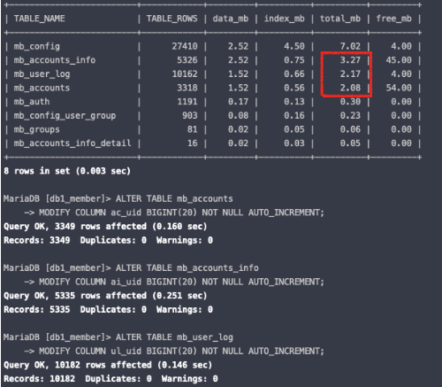
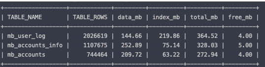

# 인덱스 튜닝

> 작성: 2025-12-04 · 태그: MariaDB, Mysql · [노션 원본](https://app.notion.com/p/2bfb71c0125780cf9568f6f88b154411)

# 작업 개요

1. db1\_member 인덱스 개선
2. db1\_member Auto increment PK 스키마 변경

---

# 인덱스 변경안

| Table | 추가 인덱스(ADD) | 삭제 인덱스(DROP) | 비고 | ALTER 명령어 |
| --- | --- | --- | --- | --- |
| <code>mb_accounts</code> | • <code>ac_vh_id_ac_userid_idx</code> (\`<code>vh_id`</code>, \`<code>ac_userid`</code>) • <code>ac_vh_id_ac_u_priv_idx</code> (\`<code>vh_id`</code>, \`<code>ac_u_priv`</code>) • <code>ac_vh_id_ac_active_idx</code> (\`<code>vh_id`</code>,\` <code>ac_active`</code>) | - |  | ALTER TABLE \`mb\_accounts\`ADD INDEX \`ac\_vh\_id\_ac\_userid\_idx\` (\`vh\_id\`,\`ac\_userid\`),ADD INDEX \`ac\_vh\_id\_ac\_u\_priv\_idx\` (\`vh\_id\`,\`ac\_u\_priv\`),ADD INDEX \`ac\_vh\_id\_ac\_active\_idx\` (\`vh\_id\`,\`ac\_active\`); |
| <code>mb_accounts_info</code> | • <code>ai_vh_id_ai_userid_idx</code> (\`<code>vh_id`</code>, \`<code>ai_userid`</code>) • <code>ai_vh_id_ai_or_id_idx </code>(\`<code>vh_id`</code>, \`<code>ai_or_id`</code>) • <code>ai_vh_id_ai_employee_number_idx </code>(\`<code>vh_id`</code>, \`<code>ai_employee_number`</code>) | - |  | ALTER TABLE \`mb\_accounts\_info\`ADD INDEX \`ai\_vh\_id\_ai\_userid\_idx\` (\`vh\_id\`,\`ai\_userid\`),ADD INDEX \`ai\_vh\_id\_ai\_or\_id\_idx\` (\`vh\_id\`, \`ai\_or\_id\`),ADD INDEX \`ai\_vh\_id\_ai\_employee\_number\_idx\` (\`vh\_id\`, \`ai\_employee\_number\`); |
| <code>mb_accounts_info_detail</code> | • <code>ad_vh_id_ai_id_idx </code>(\`<code>vh_id`</code>, \`<code>ai_id`</code>) | - |  | ALTER TABLE \`mb\_accounts\_info\_detail\`ADD INDEX \`ad\_vh\_id\_ai\_id\_idx\` (\`vh\_id\`, \`ai\_id\`); |
| <code>mb_auth</code> | • <code>au_vh_id_au_seq_idx </code>(\`<code>vh_id`</code>, \`<code>au_seq`</code>) | • <code>vh_id </code>(\`<code>vh_id`</code>, \`<code>au_type</code>,<code>au_seq`</code>) | 기존 인덱스는 컬럼 순서상 \`<code>au_type`</code> 조건이 없을 경우 활용되지 않아, \`<code>au_type`</code>을 제외한 인덱스로 변경함 | ALTER TABLE \`mb\_auth\`DROP INDEX \`vh\_id\`,ADD INDEX \`au\_vh\_id\_au\_seq\_idx\` (\`vh\_id\`,\`au\_seq\`); |
| <code>mb_config</code> | • <code>co_vh_id_name_idx </code>(\`<code>vh_id`</code>, \`<code>name`</code>) | - | 조건절에 \`name\` 없이 \`type\`으로만 조회하는 경우가 있어(\`type = 'OPTIONS'\`), 경과를 관찰한 후 \`type\` 인덱스 추가를 검토 | ALTER TABLE \`mb\_config\`ADD INDEX \`co\_vh\_id\_name\_idx\` (\`vh\_id\`, \`name\`); |
| <code>mb_config_user_group</code> | • <code>cu_vh_id_name_idx</code> (\`<code>vh_id`</code>, \`<code>name`</code>) • <code>cu_vh_id_usergroupseq_idx</code> (\`<code>vh_id`</code>, \`<code>usergroupseq`</code>) | - |  | ALTER TABLE \`mb\_config\_user\_group\`ADD INDEX \`cu\_vh\_id\_name\_idx\` (\`vh\_id\`, \`name\`),ADD INDEX \`cu\_vh\_id\_usergroupseq\_idx\` (\`vh\_id\`, \`usergroupseq\`); |
| <code>mb_groups</code> | • <code>gr_vh_id_gr_name_idx </code>(\`<code>vh_id`</code>, \`<code>gr_name`</code>) | - |  | ALTER TABLE \`mb\_groups\`ADD INDEX \`gr\_vh\_id\_gr\_name\_idx\` (\`vh\_id\`, \`gr\_name\`); |
| <code>mb_user_log</code> | - | • <code>ul_vh_id_u_seq_ul_type_idx</code>(\`<code>vh_id`</code>, \`<code>u_seq`</code>, \`<code>ul_type`</code>) | 중복된 유니크키가 있음 | ALTER TABLE \`mb\_user\_log\`DROP INDEX \`ul\_vh\_id\_u\_seq\_ul\_type\_idx\`; |

---

# 인덱스 추가 영향 분석 요약

## 1. 분석 개요

- 개발 DB에서 인덱스 추가 전·후 실측 데이터를 기반으로 디스크·메모리 영향 비율을 산출
  동일 비율을 운영 DB에 적용해 영향도를 예측함

---

## 2. 개발 DB 분석 결과

### 디스크 영향

- 주요 테이블 기준 <code>total_mb</code> 증가율: **약 20\~25%**

### 메모리 영향

- 버퍼풀 점유 증가: **약 +0.5%**
- 개발 DB에서는 여유 메모리가 충분해 영향 없음

---

## 3. 운영 DB 사전 상태

### 디스크

- 테이블 용량 기준 디스크 여유 충분

### 메모리 (InnoDB Buffer Pool)

- <code>innodb_buffer_pool_size</code>: 4GB
- FREE 페이지 비율: 약 **0.3%**
- 버퍼풀 포화 상태로 eviction 발생 가능
  - InnoDB 버퍼풀이 포화되어 지속적인 eviction이 발생하면, 페이지 교체와 내부 구조 관리 비용으로 CPU 사용량이 증가할 수 있다.

---

## 4. 운영 DB 영향 예측

### 디스크

- 개발 DB 비율 적용 시
  - 운영 테이블 기준 **약 +20\~25% 증가**
- 디스크 리스크 없음

### 메모리

- 버퍼풀 점유 증가 예상: **약 +0.5%**
- 현재 FREE 메모리 부족으로 (현재 상태도 FREE PAGE 고갈 상태)
  - 기존 hot page eviction 발생 가능
  - 일부 쿼리 응답 지연 가능성 존재

---

## 5. 결론 및 권고사항

### 결론

- 디스크 측면: 문제 없음
- 메모리 측면: 현 상태로는 리스크 존재

### 권고

- 운영 DB 적용 전
  <code>innodb_buffer_pool_size</code> **4GB → 8GB 증설 권장**

- 증설이 어려울 경우
  - **인덱스 단계적 적용**
  - 적용 후 buffer pool 지표 모니터링 필수

---

## 6. 운영 적용 체크 포인트

- 인덱스 적용 시간: 트래픽 저점
- 적용 후 확인 지표
  - <code>Innodb_buffer_pool_pages_free</code>
  - <code>Innodb_buffer_pool_reads</code>
- 적용 30\~60분 후 재측정
  SHOW GLOBAL STATUS LIKE 'Innodb\_buffer\_pool\_pages\_free';

  SHOW GLOBAL STATUS LIKE 'Innodb\_buffer\_pool\_reads';

---

## ⭐️ 최종 요약

> 인덱스 추가로 디스크 사용량은 약 20\~25% 증가하나,
>
> 운영 DB의 주요 리스크는 **디스크가 아니라 InnoDB 버퍼풀 메모리**이다.
>
> 현재 운영 DB는 버퍼풀이 포화된 상태로,
>
> 인덱스 추가 시 초기에는 인덱스 생성 과정과 기존 hot page 재적재로 인해
>
> 페이지 교체(eviction) 및 CPU 사용량 증가가 일시적으로 발생할 수 있다.
>
> 이에 따라 인덱스를 **한 번에 적용하지 않고 단계적으로 추가**하여
>
> 초기 buffer pool churn을 분산한다.
>
> **작업 계획**
>
> 1\. 인덱스 추가 날짜 분리 (ex. accounts 인덱스 1/20, accounts\_info 인덱스 1/21 )
>
> 2\. 핑거프린트는 인덱스 추가와는 무관. 하지만 정리는 필요해 보임. (디스크 용량)

---

# Auto increment PK schema 변경

: 작업간에 쓰기 LOCK 발생함

| 테이블명 | 컬럼명 | 현재 수치 | DDL |
| --- | --- | --- | --- |
| mb\_user\_log | ul\_uid | 1,116,488,896 | ALTER TABLE mb\_user\_log MODIFY COLUMN ul\_uid BIGINT(20) NOT NULL AUTO\_INCREMENT; |
| mb\_accounts\_info | ai\_uid | 1,018,440,262 | ALTER TABLE mb\_accounts\_info MODIFY COLUMN ai\_uid BIGINT(20) NOT NULL AUTO\_INCREMENT; |
| mb\_accounts | ac\_uid | 520,896,154 | ALTER TABLE mb\_accounts MODIFY COLUMN ac\_uid BIGINT(20) NOT NULL AUTO\_INCREMENT; |

## 운영 DB PK 변경 예상 소요시간(테이블별)

### 테스트존 DB 소요시간

### 운영 DB 현재 용량

평균을 잡으면 대략:

- **약 0.074초/MB** (≈ 13.5 MB/s 수준)

이 값을 운영 테이블 <code>total_mb</code>에 선형 적용한다.

운영 테이블 용량 :

- <code>mb_accounts</code> : **272.94 MB**
- <code>mb_accounts_info</code> : **328.03 MB**
- <code>mb_user_log</code> : **364.52 MB**

예상 시간 = total\_mb × 0.074초/MB

- <code>mb_accounts</code> ≈ 272.94 × 0.074 = **약 20초**
- <code>mb_accounts_info</code> ≈ 328.03 × 0.074 = **약 24초**
- <code>mb_user_log</code> ≈ 364.52 × 0.074 = **약 27초**

### 합계(순차 실행 기준)

- **약 71초(= 1분 10초)**
